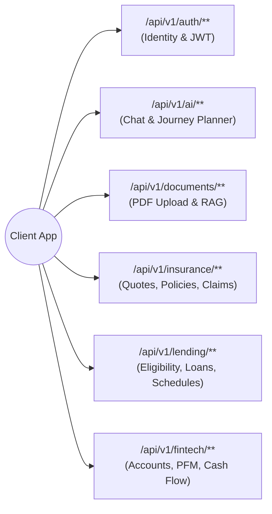

# FinPath AI — Comprehensive REST API Specification

**API Version:** 1.0.0 (v1)  
**Base URL:** `https://api.finpath.ai/api/v1` (Production) / `http://localhost:8080/api/v1` (Local Docker)  
**Specification Format:** OpenAPI 3.1 / RFC 7807 Compliant  
**Security Protocols:** Bearer JWT (RS256) / TLS 1.3  

---

## 1. Global Architectural Conventions & Standards

### 1.1 Request Headers

| Header | Type | Description |
| :--- | :--- | :--- |
| `Authorization` | String | Format: `Bearer <jwt_token>` (Required for all protected endpoints) |
| `Content-Type` | String | `application/json` (or `multipart/form-data` for document uploads) |
| `X-Correlation-ID` | UUID | Client-generated or Gateway-assigned tracing ID for distributed logging |
| `Idempotency-Key` | UUID | Required on non-safe mutations (e.g., loan submissions, claim filings) |

### 1.2 Unified Response Envelope

All API endpoints return standard JSON responses. Success responses wrap payload data under a root `data` key, alongside pagination metadata where applicable.

```json
{
  "success": true,
  "data": { ... },
  "meta": {
    "page": 0,
    "size": 20,
    "totalElements": 142,
    "totalPages": 8
  },
  "timestamp": "2026-11-08T00:15:30Z"
}
```

### 1.3 Standard Error Responses (RFC 7807 `ProblemDetail`)

Errors strictly adhere to the IETF RFC 7807 Problem Details specification:

```json
{
  "type": "https://api.finpath.ai/errors/loan-ineligible",
  "title": "Debt-To-Income Threshold Exceeded",
  "status": 422,
  "detail": "Calculated DTI ratio of 54.2% exceeds the maximum allowable threshold of 50.0% for Product 'Prime Auto Loan'.",
  "instance": "/api/v1/lending/applications",
  "timestamp": "2026-11-08T00:15:30Z",
  "invalidParams": [
    {
      "field": "requestedAmount",
      "reason": "Principal repayment forces monthly debt obligations above acceptable safety margins."
    }
  ]
}
```

---

## 2. API Endpoint Matrix by Domain



---

## 3. Detailed Endpoint Specifications

### 3.1 Authentication & Profile Module

#### `POST /api/v1/auth/register`
Creates a new customer identity record.

**Request Payload:**
```json
{
  "email": "sarah.connor@example.com",
  "password": "SecurePassword123!",
  "firstName": "Sarah",
  "lastName": "Connor",
  "phoneNumber": "+14155552671"
}
```
**Response (201 Created):**
```json
{
  "success": true,
  "data": {
    "userId": "9b1deb4d-3b7d-4bad-9bdd-2b0d7b3dcb6d",
    "email": "sarah.connor@example.com",
    "roles": ["ROLE_CUSTOMER"],
    "accessToken": "eyJhbGciOiJSUzI1NiIsInR5cCI6IkpXVCJ9...",
    "expiresInSeconds": 900
  }
}
```

#### `POST /api/v1/auth/login`
Authenticates user and returns access token.

**Request Payload:**
```json
{
  "email": "sarah.connor@example.com",
  "password": "SecurePassword123!"
}
```
**Response (200 OK):**
```json
{
  "success": true,
  "data": {
    "userId": "9b1deb4d-3b7d-4bad-9bdd-2b0d7b3dcb6d",
    "accessToken": "eyJhbGciOiJSUzI1NiIsInR5cCI6IkpXVCJ9...",
    "expiresInSeconds": 900
  }
}
```

---

### 3.2 AI Orchestrator & Document RAG Module

#### `POST /api/v1/ai/chat/sessions`
Initializes a new conversational session with the financial advisor.

**Response (201 Created):**
```json
{
  "success": true,
  "data": {
    "sessionId": "c3a17e08-96ef-466a-bc9e-8848d591e1d0",
    "title": "New Financial Journey",
    "createdAt": "2026-11-08T00:20:00Z"
  }
}
```

#### `POST /api/v1/ai/chat/sessions/{sessionId}/messages`
Sends a query to the Central AI Orchestrator. Supports both standard JSON and Server-Sent Events (`Accept: text/event-stream`) for streaming tokens.

**Request Payload:**
```json
{
  "message": "I'm looking to buy a home for $400,000. Based on my current savings, loan eligibility, and insurance requirements, what is my step-by-step path?",
  "includeDomainData": true
}
```

**Response (200 OK):**
```json
{
  "success": true,
  "data": {
    "messageId": "fa735a29-236b-4e09-9b98-ea1b65e90e72",
    "senderRole": "ASSISTANT",
    "content": "Based on your aggregated financial profile, here is your tailored 3-step homeownership plan:\n\n1. **Lending Assessment**: You qualify for a **Conventional 30-Year Fixed Loan** up to $360,000 at 6.15% APR. Your current DTI is 31.4%, which is within our healthy safety threshold (<43%).\n2. **Down Payment & Cash Flow**: Your current savings across linked accounts total $68,400. You need $40,000 for a 10% down payment, leaving an emergency reserve of $28,400.\n3. **Insurance Protection**: You will require homeowners insurance with an estimated annual premium of $1,800 ($150/mo) and Private Mortgage Insurance (PMI) of approximately $120/mo until 20% equity is achieved.",
    "toolInvocations": [
      {
        "tool": "LendingModule.calculateEligibility",
        "parameters": { "targetAmount": 360000, "termMonths": 360 },
        "result": { "eligible": true, "maxEligibleAmount": 410000, "estimatedEmi": 2192.45 }
      },
      {
        "tool": "FintechModule.getCashFlowSummary",
        "parameters": {},
        "result": { "liquidSavings": 68400.00, "monthlyNetSurplus": 1850.00 }
      },
      {
        "tool": "InsuranceModule.estimateHomeInsurance",
        "parameters": { "propertyValue": 400000 },
        "result": { "annualPremium": 1800.00 }
      }
    ],
    "citations": [
      {
        "documentId": "1a3b5c7d-8e9f-4a1b-2c3d-4e5f6a7b8c9d",
        "documentName": "Underwriting_Guidelines_2026.pdf",
        "pageNumber": 14,
        "textExcerpt": "Conforming loan limits require a minimum credit score of 620 with maximum DTI not exceeding 43%."
      }
    ]
  }
}
```

#### `POST /api/v1/documents/upload`
Uploads a financial PDF or receipt for OCR extraction, chunking, and vector indexing.

**Request:** `multipart/form-data`
- `file`: `[Binary PDF File]`
- `category`: `INSURANCE_POLICY` | `PAYSLIP` | `TAX_RETURN` | `CLAIM_RECEIPT`

**Response (202 Accepted):**
```json
{
  "success": true,
  "data": {
    "documentId": "1a3b5c7d-8e9f-4a1b-2c3d-4e5f6a7b8c9d",
    "fileName": "Liberty_Mutual_Policy_Schedule.pdf",
    "fileSizeBytes": 2048576,
    "status": "PROCESSING",
    "estimatedCompletionSeconds": 5
  }
}
```

#### `GET /api/v1/documents/{documentId}/status`
Polls the vector indexing status for a document.

**Response (200 OK):**
```json
{
  "success": true,
  "data": {
    "documentId": "1a3b5c7d-8e9f-4a1b-2c3d-4e5f6a7b8c9d",
    "status": "INDEXED",
    "chunksIndexed": 18,
    "extractedSummary": "Comprehensive Homeowners HO-3 Policy with $400,000 dwelling coverage, $1,000 deductible, and exclusions for flood and earthquake damage."
  }
}
```

---

### 3.3 Insurance Module

#### `GET /api/v1/insurance/products`
Retrieves the catalog of available insurance policies with optional category filter.

**Query Parameters:** `category=HEALTH` (optional)  
**Response (200 OK):**
```json
{
  "success": true,
  "data": [
    {
      "id": "e4f8d2a1-6a23-4b61-9c32-1a482b54d190",
      "carrierName": "Aegis National Life",
      "productName": "Term Life 20-Year Level",
      "category": "TERM_LIFE",
      "basePremiumMonthly": 35.50,
      "coverageAmountMin": 100000.00,
      "coverageAmountMax": 2000000.00,
      "termsSummary": "Level premium guaranteed for 20 years. Includes accelerated death benefit."
    }
  ]
}
```

#### `POST /api/v1/insurance/quotes/calculate`
Calculates an underwriting quote based on coverage request and health risk variables.

**Request Payload:**
```json
{
  "productId": "e4f8d2a1-6a23-4b61-9c32-1a482b54d190",
  "coverageAmount": 500000.00,
  "isSmoker": false,
  "hasPreExistingConditions": false,
  "occupationRiskClass": "CLASS_1_LOW"
}
```

**Response (200 OK):**
```json
{
  "success": true,
  "data": {
    "quoteId": "7d9c1b3f-54a2-4e89-bd01-3829ad48301f",
    "carrierName": "Aegis National Life",
    "coverageSelected": 500000.00,
    "quotedPremiumMonthly": 42.75,
    "deductible": 0.00,
    "riskScore": 18.5,
    "status": "DRAFT",
    "expiresAt": "2026-12-08T00:00:00Z"
  }
}
```

#### `POST /api/v1/insurance/claims`
Submits a digital insurance claim with supporting document references.

**Request Payload:**
```json
{
  "policyId": "d8205f12-0cf7-497d-8153-6a978d380e21",
  "claimAmount": 3450.00,
  "incidentDate": "2026-11-01",
  "incidentDescription": "Water pipe leak in kitchen resulting in drywall and floor damage.",
  "documentIds": ["1a3b5c7d-8e9f-4a1b-2c3d-4e5f6a7b8c9d"]
}
```

**Response (201 Created):**
```json
{
  "success": true,
  "data": {
    "claimId": "b8a9c2d1-9f8e-4a3b-8c2d-1e4f5a6b7c8d",
    "claimNumber": "CLM-2026-84920",
    "status": "SUBMITTED",
    "aiFraudRiskScore": 8.2,
    "triageResult": "AUTO_FORWARDED_TO_FAST_TRACK_ADJUDICATION"
  }
}
```

---

### 3.4 Lending Module

#### `POST /api/v1/lending/eligibility/pre-qualify`
Evaluates instant borrowing limits without affecting the user's hard credit bureau score.

**Request Payload:**
```json
{
  "loanType": "PERSONAL",
  "requestedAmount": 25000.00,
  "preferredTermMonths": 36
}
```

**Response (200 OK):**
```json
{
  "success": true,
  "data": {
    "isPreQualified": true,
    "maxEligibleAmount": 35000.00,
    "estimatedApr": 0.0749,
    "calculatedDti": 28.60,
    "projectedMonthlyEmi": 777.58,
    "recommendations": [
      "Borrowing at 36 months keeps your total interest paid under $2,995.",
      "Increasing tenure to 48 months lowers monthly payment to $604.42."
    ]
  }
}
```

#### `POST /api/v1/lending/applications`
Submits a formal loan application for credit decisioning.

**Request Payload:**
```json
{
  "loanProductId": "3d5f7b9a-1c2e-4a6b-8d0f-2a4b6c8e0f1a",
  "requestedAmount": 25000.00,
  "requestedTermMonths": 36,
  "loanPurpose": "DEBT_CONSOLIDATION",
  "supportingDocumentIds": ["8c2d1e4f-5a6b-7c8d-9e0f-1a2b3c4d5e6f"]
}
```

**Response (201 Created):**
```json
{
  "success": true,
  "data": {
    "applicationId": "4c6e8a0b-2d4f-6a8c-0e2b-4a6c8e0f2a4b",
    "applicationNumber": "LOAN-2026-99381",
    "status": "UNDERWRITING",
    "calculatedDti": 28.60,
    "submittedAt": "2026-11-08T00:25:00Z"
  }
}
```

#### `GET /api/v1/lending/applications/{applicationId}/repayment-schedule`
Fetches the full loan amortization table for a loan application.

**Response (200 OK):**
```json
{
  "success": true,
  "data": {
    "applicationNumber": "LOAN-2026-99381",
    "totalPrincipal": 25000.00,
    "totalInterest": 2992.88,
    "schedule": [
      {
        "installmentNumber": 1,
        "dueDate": "2026-12-08",
        "principalDue": 621.54,
        "interestDue": 156.04,
        "totalPaymentDue": 777.58,
        "remainingBalance": 24378.46,
        "status": "PENDING"
      },
      {
        "installmentNumber": 2,
        "dueDate": "2027-01-08",
        "principalDue": 625.42,
        "interestDue": 152.16,
        "totalPaymentDue": 777.58,
        "remainingBalance": 23753.04,
        "status": "PENDING"
      }
    ]
  }
}
```

---

### 3.5 Fintech Module (PFM & Wealth)

#### `GET /api/v1/fintech/accounts`
Returns all aggregated checking, savings, credit, and investment accounts.

**Response (200 OK):**
```json
{
  "success": true,
  "data": {
    "totalNetWorth": 84250.00,
    "accounts": [
      {
        "id": "11223344-5566-7788-99aa-bbccddeeff00",
        "institutionName": "Chase Bank",
        "accountType": "CHECKING",
        "accountMask": "•••• 9123",
        "currency": "USD",
        "currentBalance": 12450.00,
        "availableBalance": 12100.00,
        "lastSyncedAt": "2026-11-08T00:10:00Z"
      },
      {
        "id": "22334455-6677-8899-aabb-ccddeeff0011",
        "institutionName": "Vanguard",
        "accountType": "INVESTMENT",
        "accountMask": "•••• 3481",
        "currency": "USD",
        "currentBalance": 71800.00,
        "availableBalance": 71800.00,
        "lastSyncedAt": "2026-11-08T00:10:00Z"
      }
    ]
  }
}
```

#### `GET /api/v1/fintech/transactions`
Retrieves paginated transactions with category, date, and account filtering.

**Query Parameters:** `page=0&size=20&startDate=2026-10-01&endDate=2026-10-31&category=GROCERIES`  
**Response (200 OK):**
```json
{
  "success": true,
  "data": [
    {
      "id": "33445566-7788-99aa-bbcc-ddeeff001122",
      "accountId": "11223344-5566-7788-99aa-bbccddeeff00",
      "amount": -142.85,
      "currency": "USD",
      "transactionDate": "2026-10-28",
      "merchantName": "Trader Joe's #142",
      "cleanMerchantName": "Trader Joe's",
      "category": "GROCERIES",
      "isRecurring": false,
      "status": "POSTED"
    }
  ],
  "meta": {
    "page": 0,
    "size": 20,
    "totalElements": 84,
    "totalPages": 5
  }
}
```

#### `GET /api/v1/fintech/cashflow/forecast`
Returns the 30-day liquidity and cash-flow projection generated by AI/time-series forecasting.

**Response (200 OK):**
```json
{
  "success": true,
  "data": {
    "currentLiquidCash": 12450.00,
    "projectedCashIn30Days": 14320.00,
    "expectedInflows30Days": 6200.00,
    "expectedOutflows30Days": 4330.00,
    "burnRateDailyAverage": 144.33,
    "liquidityHealth": "EXCELLENT",
    "forecastPoints": [
      {
        "date": "2026-11-09",
        "projectedBalance": 12380.00,
        "confidenceLow": 12200.00,
        "confidenceHigh": 12560.00
      },
      {
        "date": "2026-11-15",
        "projectedBalance": 15480.00,
        "confidenceLow": 15200.00,
        "confidenceHigh": 15760.00
      }
    ]
  }
}
```

