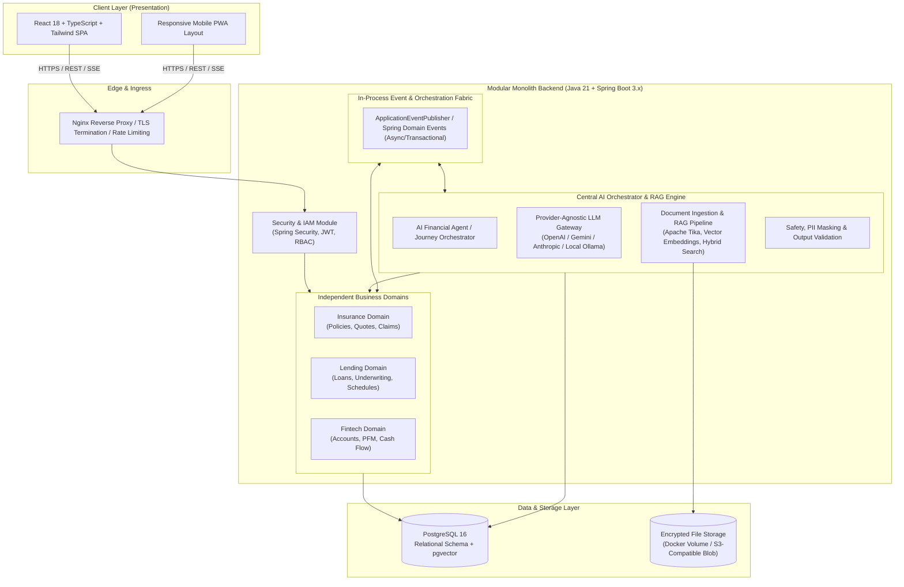
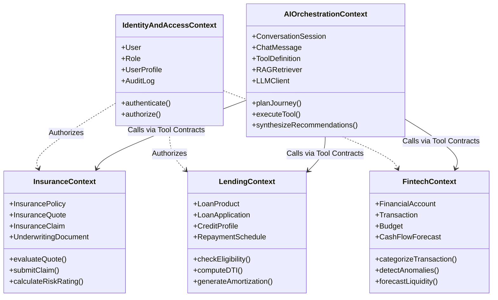
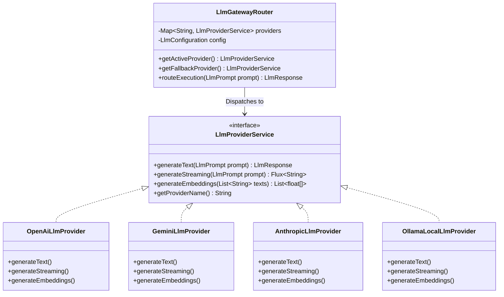
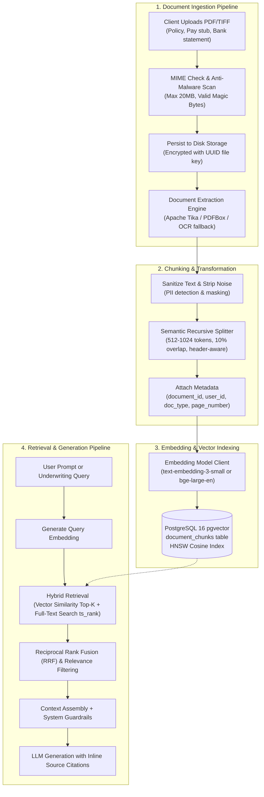
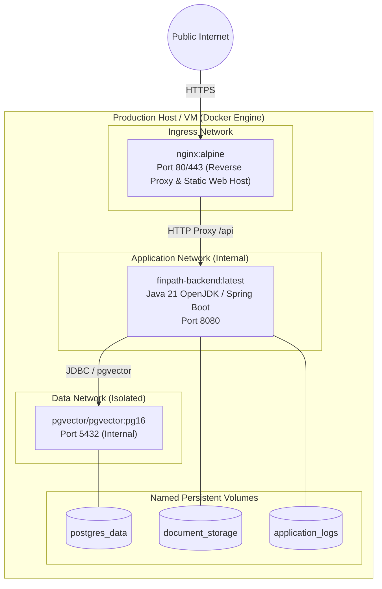

# FinPath AI — Enterprise System Architecture Document

**Document Version:** 1.0.0  
**Status:** Approved for Architectural Review (Phase 1 Deliverable)  
**Target Platform:** FinPath AI Financial Journey Platform (Insurance, Lending, Fintech)  
**Author:** Lead Software Architect  

---

## 1. Executive Summary & Architectural Vision

FinPath AI is an intelligent, integrated financial journey platform designed to unify three foundational pillars of consumer and SME finance:
1. **Insurance**: Personalized policy matching, policy document analysis, automated quote comparison, and intelligent claims triage.
2. **Lending**: Credit pre-qualification, loan application management, automated debt-to-income (DTI) computation, and AI-assisted underwriting.
3. **Fintech**: Aggregated account management, categorization of financial transactions, dynamic cash-flow forecasting, and automated budget optimization.

At the core of FinPath AI sits the **Central AI Orchestrator**, an autonomous reasoning and RAG (Retrieval-Augmented Generation) engine that breaks down organizational silos across these three verticals. It synthesizes disparate financial signals (e.g., an insurance claim triggering a loan restructuring recommendation, or budget surplus prompting savings into an insurance endowment) into actionable financial guidance.



---

## 2. Architectural Paradigm: Modular Monolith vs. Microservices

### 2.1 The Architectural Decision

For Phase 1 and initial production scale (up to 500,000 monthly active users and 50M records), FinPath AI adopts a **Domain-Driven Modular Monolith (Modulith)** architecture implemented in Java 21 and Spring Boot 3.

```mermaid
graph LR
    A["Early Microservices Anti-pattern\n- Network latency & serialization overhead\n- Distributed transactions & 2PC complexity\n- Premature operational burdens\n- Complex CI/CD & orchestration"] 
    -->|Rejected for| 
    B["Domain-Driven Modular Monolith\n+ In-memory zero-latency domain events\n+ ACID transactions when critical\n+ Strict module boundary enforcement (ArchUnit)\n+ Single deployment unit (Docker)\n+ Ready for microservice extraction if needed"]
```

### 2.2 Boundary Enforcement Strategy
1. **Module Independence**: The `insurance`, `lending`, and `fintech` packages maintain their own internal repositories, service layers, and domain models.
2. **Interface Contracts**: Direct cross-module database foreign-key joins across domains are strictly forbidden. Domains communicate via:
   - Shared read-only Projection DTOs.
   - Strictly typed In-Memory Domain Events (`ApplicationEventPublisher`).
3. **ArchUnit Verification**: Architecture tests verify at compile/test time that internal module classes (e.g., `com.finpath.insurance.internal.*`) are never imported by `lending` or `fintech`.

---

## 3. High-Level System Architecture & Component Interactions

### 3.1 Tier Breakdown

| Tier | Technology Stack | Core Responsibilities |
| :--- | :--- | :--- |
| **Frontend** | React 18, TypeScript, Tailwind CSS, Vite, TanStack Query, Zustand, Lucide React, Shadcn/UI primitives | Responsive UI, state caching, client-side validation, secure token handling, streaming AI responses (Server-Sent Events). |
| **API Gateway / Proxy** | Nginx Reverse Proxy (Dockerized) | SSL/TLS termination, HTTP/2 multiplexing, CORS enforcement, gzip/brotli compression, rate limiting (burst protection). |
| **Backend Core** | Java 21 (LTS), Spring Boot 3.3+, Spring Security 6, Spring Data JPA, Hibernate 6, Flyway | REST APIs, business validation, JWT verification, orchestration, transaction management, virtual threads (Project Loom). |
| **AI Orchestration** | Provider-independent abstraction (Java SPI / Spring Service interfaces), LangChain4j / Custom HTTP Clients | Prompt lifecycle, context assembly, multi-turn conversation memory, intent routing, function calling, tool execution. |
| **Document & RAG** | Apache Tika / PDFBox, pgvector extension for PostgreSQL | Text extraction, recursive markdown-aware chunking, vector embedding generation, cosine similarity search, citation indexing. |
| **Database** | PostgreSQL 16 with `pgvector` extension | Relational domain storage, JSONB for dynamic metadata, Vector embeddings (1536-dim), transactional integrity. |
| **Storage** | Encrypted Local File Volume (Docker) / S3 Object Store interface | Secure storage of raw uploaded loan and insurance PDF documents with AES-256 at-rest encryption. |

---

## 4. Domain-Driven Design (DDD) Bounded Contexts



### 4.1 Insurance Bounded Context
- **Responsibilities**:
  - Cataloging life, health, auto, and property insurance plans.
  - Generating comparative quotes based on demographic and lifestyle indicators.
  - Intake of digital claims with supporting bill/receipt uploads.
  - Document extraction for pre-existing conditions and policy exclusions.
- **Invariants**: A claim cannot exceed the policy's maximum sum assured. A quote expires after 30 days.

### 4.2 Lending Bounded Context
- **Responsibilities**:
  - Processing personal, auto, and SME mortgage loan applications.
  - Computing dynamic Debt-to-Income (DTI), Loan-to-Value (LTV), and credit risk scores.
  - Generating compound-interest amortization schedules (Equal Monthly Installments - EMI).
  - Tracking approval status from draft to underwriting, disbursement, and settlement.
- **Invariants**: Loan application requires verified identity documents. DTI exceeding 50% triggers high-risk flag requiring manual underwriter sign-off.

### 4.3 Fintech (PFM & Wealth) Bounded Context
- **Responsibilities**:
  - Managing checking, savings, investment, and credit accounts.
  - Categorizing debit and credit transactions with rule-based and AI fallback classifiers.
  - Monthly budget limit enforcement with threshold alerting.
  - 30-60-90 day forward-looking cash flow and liquidity forecasting.
- **Invariants**: Account ledger must balance; total expenses and incomes reconcile against reported balances.

### 4.4 Central AI Orchestrator Bounded Context
- **Responsibilities**:
  - Acting as the cognitive hub for user financial queries.
  - Classifying user intent across Insurance, Lending, and Fintech verticals.
  - Selecting and invoking domain tools (Function Calling) safely.
  - Ingesting, chunking, embedding, and indexing financial PDFs (policies, pay stubs, bank statements).
  - Generating human-readable, explainable recommendations with citations.

---

## 5. Central AI Orchestration Architecture

### 5.1 Provider-Independent LLM Gateway
To eliminate vendor lock-in with OpenAI, Anthropic, or Google Gemini, the platform relies on a decoupled abstraction layer:



#### Key Design Highlights:
1. **Dynamic Fallback Circuit**: If the primary provider (e.g., Anthropic Claude 3.5 Sonnet) encounters a 429 Rate Limit or 5xx server error, the `LlmGatewayRouter` trips a circuit breaker and automatically redirects the query to a secondary provider (e.g., Google Gemini 1.5 Pro or OpenAI GPT-4o) with identical prompt contracts.
2. **Standardized Token and Cost Accounting**: All requests pass through an interceptor tracking prompt tokens, completion tokens, response latency, and calculated USD expenditure logged to `ai_agent_executions`.

### 5.2 Inter-Module Communication Protocol (Domain Tools)

When a user submits a natural-language request (e.g., *"Can I afford a $25,000 car loan given my current rent and spending?"*), the Central AI Orchestrator executes a multi-step cognitive pipeline:

```mermaid
sequenceDiagram
    autonumber
    actor User as User (Web Client)
    participant ChatAPI as AI Chat Controller
    participant Orchestrator as Central AI Orchestrator
    participant Router as Intent & Tool Planner
    participant FintechMod as Fintech Domain Service
    participant LendingMod as Lending Domain Service
    participant RAG as RAG Knowledge Engine
    participant LLM as Provider-Agnostic LLM

    User->>ChatAPI: POST /api/v1/ai/chat/query {"message": "Can I afford a $25k loan with my spending?"}
    ChatAPI->>Orchestrator: orchestrate(userId, query)
    Orchestrator->>Router: analyzeIntent(query, userContext)
    Router->>LLM: Formulate Tool Call Plan (Schema definitions passed)
    LLM-->>Router: ToolCall: [Fintech.getMonthlyCashFlowSummary, Lending.calculateLoanEligibility]
    
    par Query Financial Data
        Router->>FintechMod: getMonthlyCashFlowSummary(userId)
        FintechMod-->>Router: Monthly Surplus: $1,450; Recurring Debt: $320
    and Check Loan Constraints
        Router->>LendingMod: calculateLoanEligibility(userId, 25000, 48 months)
        LendingMod-->>Router: Monthly EMI: $585; Max DTI: 36%; Qualified: true
    end

    Router->>RAG: fetchPolicyExcerpts("auto loan underwriting rules")
    RAG-->>Router: Underwriting Policy Document Rules
    
    Router->>LLM: Synthesize Final Recommendation(CashFlow, LoanEMI, PolicyRules)
    LLM-->>Orchestrator: Structured Response with explanation & actionable link
    Orchestrator-->>ChatAPI: Formatted Answer + Action Cards (Apply Loan, Adjust Budget)
    ChatAPI-->>User: 200 OK (Rendered with interactive chart & pre-filled application)
```

### 5.3 Asynchronous Domain Events
When operations occur within one of the financial domains, they emit asynchronous domain events via Spring's `ApplicationEventPublisher`. The AI Orchestrator listens to these events to update context, trigger background evaluations, or provide proactive advice:

| Emitted Event | Source Domain | AI Orchestrator Reaction |
| :--- | :--- | :--- |
| `TransactionCategorizedEvent` | Fintech | If anomalous spending or recurring subscription increase is detected, notify user or revise monthly savings projections. |
| `LoanApplicationSubmittedEvent` | Lending | Run automated RAG document extraction on submitted payslips/tax forms; compute recommended risk rating for loan officer. |
| `InsuranceClaimFiledEvent` | Insurance | Cross-reference claim itemization against policy exclusions in vector store; evaluate if emergency fund disbursement or loan moratorium is advised. |

---

## 6. Document Processing & RAG Pipeline Architecture



---

## 7. Security, Compliance, and Data Governance

### 7.1 Authentication & Authorization
- **Stateless JWT Architecture**: Access tokens (15-minute TTL) signed with asymmetric RS256; Refresh tokens (7-day TTL) stored in HTTP-only, Secure, SameSite cookies with database session revocation.
- **Role-Based & Attribute-Based Access Control (RBAC/ABAC)**:
  - `ROLE_CUSTOMER`: Access to own accounts, applications, claims, quotes.
  - `ROLE_LOAN_OFFICER`: Review, underwrite, and approve loan applications across assigned portfolios.
  - `ROLE_UNDERWRITER`: Review, assess, and adjudicate insurance claims and high-limit policies.
  - `ROLE_ADMIN`: Platform configuration, user management, audit review, LLM gateway parameter tuning.

### 7.2 Financial Data Protection & PII Masking
1. **At-Rest Encryption**: Sensitive columns (Social Security Number / National ID, Bank Account Numbers, Cardholder details) are encrypted using AES-256-GCM via JPA Attribute Converters before writing to PostgreSQL.
2. **AI Boundary Masking**: Before any user document excerpt or prompt is dispatched to external LLM APIs:
   - A deterministic regex and NLP scrubber masks SSNs, account numbers, physical addresses, and telephone numbers.
   - Masked tokens are stored in an ephemeral request cache so responses can be rehydrated for the authenticated user without exposing PII to external model providers.
3. **Audit Trails**: Every sensitive read or write to financial records generates an immutable entry in `audit_logs` storing `user_id`, `client_ip`, `action`, `resource_id`, `before_state`, and `after_state`.

---

## 8. Non-Functional Requirements & Resilience Strategy

### 8.1 Resilience & Fault Tolerance
- **Resilience4j Circuit Breakers**: Applied around external LLM API calls, external banking aggregator webhooks, and PDF processing pipelines.
  - Failure rate threshold: 50% over 10 calls.
  - Wait duration in open state: 10,000ms.
- **Graceful Degradation**: If AI services become unavailable, the platform automatically drops into deterministic mode: loan eligibility reverts to pure rule-based evaluation, and chat assistant presents a friendly degraded-mode banner.

### 8.2 Caching Topology
- **Layer 1 (In-Memory)**: Caffeine Cache for static product catalogs (insurance plans, loan tiers, interest rates) with a 1-hour TTL.
- **Layer 2 (Distributed/Query)**: Vector similarity cache in PostgreSQL for duplicate frequently-asked policy queries.

### 8.3 Observability & Telemetry
- **Micrometer & Prometheus**: Metrics collected for HTTP request duration, DB connection pool utilization (HikariCP), LLM token consumption, and RAG retrieval latency.
- **Structured JSON Logging**: Logback configured with MDC (Mapped Diagnostic Context) capturing `traceId`, `spanId`, and `userId` across all threads.

---

## 9. Containerization & Deployment Topology

The entire application runs in a unified Docker network orchestrated via `docker-compose.yml`:



---

## 10. Summary Matrix of Architectural Trade-offs

| Architectural Dimension | Chosen Option | Alternative Considered | Rationale for Choice |
| :--- | :--- | :--- | :--- |
| **Backend Topology** | Modular Monolith | Microservices | Eliminates distributed transaction overhead and deployment complexity while preserving clean domain separation through Java packages and module contracts. |
| **Vector Database** | PostgreSQL + `pgvector` | Dedicated (Pinecone/Milvus/Qdrant) | Keeps relational and vector data in a single transactional engine with unified backups, ACID transactions, and zero additional cloud costs. |
| **LLM Integration** | Custom Provider-Agnostic Abstraction | Direct OpenAI SDK | Prevents vendor lock-in, enables seamless switching between OpenAI, Gemini, Anthropic, and local models without changing business logic. |
| **Inter-Domain Comms** | Spring Application Events (Async) | Apache Kafka / RabbitMQ | Zero operational infrastructure overhead for initial scale; can be replaced with an external message broker later with minimal code changes. |
| **Document Extraction** | Apache Tika / PDFBox | External SaaS (AWS Textract) | Avoids third-party per-page fees and ensures zero data leakage for confidential user financial documents. |

