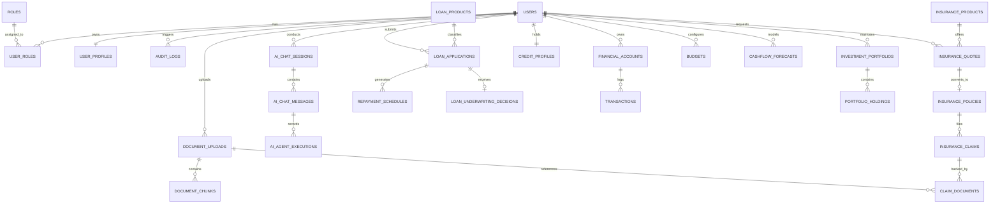

# FinPath AI — Comprehensive Database Schema & Data Architecture

**Database Engine:** PostgreSQL 16  
**Extensions Required:** `uuid-ossp`, `pgcrypto`, `vector` (pgvector)  
**Schema Version:** 1.0.0 (Flyway Baseline)  
**Target Architecture:** Modular Monolith with Domain-Driven Data Partitioning  

---

## 1. Schema Design Principles & Conventions

1. **Primary Keys**: Every table uses a `UUID` primary key (`DEFAULT gen_random_uuid()`) to eliminate enumeration attacks and facilitate seamless future microservice data extraction.
2. **Financial Precision**: All monetary values are strictly typed as `NUMERIC(15, 2)` (or `NUMERIC(19, 4)` for interest rates and investment units). The use of floating-point types (`REAL`, `DOUBLE PRECISION`) is strictly prohibited.
3. **Audit Trail**: Every entity contains `created_at TIMESTAMPTZ NOT NULL DEFAULT CURRENT_TIMESTAMP`, `updated_at TIMESTAMPTZ NOT NULL DEFAULT CURRENT_TIMESTAMP`, and `version BIGINT NOT NULL DEFAULT 0` for optimistic locking.
4. **Soft Deletions**: Tables containing transactional records implement `deleted_at TIMESTAMPTZ NULL` to maintain strict historical and compliance integrity.
5. **Vector Store**: Unstructured document semantics and RAG embeddings are stored in PostgreSQL using the `vector(1536)` data type, indexed with Hierarchical Navigable Small World (`HNSW`) cosine similarity indexes.
6. **Encrypted Columns**: PII columns (National ID / SSN, Bank Account Numbers) store Base64 ciphertext encrypted via application-level AES-256-GCM.

---

## 2. High-Level Entity-Relationship Overview



---

## 3. Data Dictionary by Bounded Context

### 3.1 Identity, Access Management & Auditing

#### Table: `users`
Represents the core identity account for customers, officers, and administrators.

| Column | Type | Constraints | Description |
| :--- | :--- | :--- | :--- |
| `id` | UUID | PRIMARY KEY, DEFAULT gen_random_uuid() | Unique identifier |
| `email` | VARCHAR(255) | NOT NULL, UNIQUE | Canonical email for login |
| `password_hash` | VARCHAR(255) | NOT NULL | BCrypt / Argon2id salted hash |
| `first_name` | VARCHAR(100) | NOT NULL | User's legal first name |
| `last_name` | VARCHAR(100) | NOT NULL | User's legal last name |
| `phone_number` | VARCHAR(30) | NULL | Normalized E.164 phone number |
| `status` | VARCHAR(30) | NOT NULL DEFAULT 'ACTIVE' | `PENDING_VERIFICATION`, `ACTIVE`, `SUSPENDED` |
| `is_mfa_enabled` | BOOLEAN | NOT NULL DEFAULT FALSE | Multi-factor authentication flag |
| `mfa_secret` | VARCHAR(255) | NULL | Encrypted TOTP secret key |
| `created_at` | TIMESTAMPTZ | NOT NULL DEFAULT CURRENT_TIMESTAMP | Creation timestamp |
| `updated_at` | TIMESTAMPTZ | NOT NULL DEFAULT CURRENT_TIMESTAMP | Last update timestamp |
| `deleted_at` | TIMESTAMPTZ | NULL | Soft delete marker |

#### Table: `roles` & `user_roles`
Defines permissions and role associations.

| Table | Columns & Constraints |
| :--- | :--- |
| `roles` | `id` (VARCHAR(50) PK, e.g. 'ROLE_CUSTOMER', 'ROLE_LOAN_OFFICER', 'ROLE_UNDERWRITER', 'ROLE_ADMIN'), `description` (VARCHAR(255)) |
| `user_roles` | `user_id` (UUID FK -> users.id), `role_id` (VARCHAR(50) FK -> roles.id), PRIMARY KEY (`user_id`, `role_id`) |

#### Table: `user_profiles`
Stores extended customer data including encrypted PII.

| Column | Type | Constraints | Description |
| :--- | :--- | :--- | :--- |
| `id` | UUID | PRIMARY KEY, DEFAULT gen_random_uuid() | Unique identifier |
| `user_id` | UUID | NOT NULL UNIQUE FK -> users.id | Associated user account |
| `date_of_birth` | DATE | NOT NULL | Date of birth for eligibility & insurance |
| `encrypted_national_id` | TEXT | NOT NULL | AES-256 encrypted SSN / National Identity |
| `national_id_hash` | VARCHAR(64) | NOT NULL INDEX | SHA-256 blind index for lookup queries |
| `employment_status` | VARCHAR(50) | NOT NULL | `EMPLOYED`, `SELF_EMPLOYED`, `RETIRED`, `UNEMPLOYED` |
| `annual_income` | NUMERIC(15, 2) | NOT NULL DEFAULT 0.00 | Self-reported or verified gross income |
| `risk_tolerance` | VARCHAR(30) | NOT NULL DEFAULT 'MODERATE' | `CONSERVATIVE`, `MODERATE`, `AGGRESSIVE` |
| `address_line1` | VARCHAR(255) | NOT NULL | Street address |
| `city` | VARCHAR(100) | NOT NULL | City |
| `state_province` | VARCHAR(100) | NOT NULL | State or province |
| `postal_code` | VARCHAR(20) | NOT NULL | Postal / ZIP code |
| `country_code` | VARCHAR(3) | NOT NULL DEFAULT 'USA' | ISO-3166 alpha-3 country code |
| `created_at` | TIMESTAMPTZ | NOT NULL DEFAULT CURRENT_TIMESTAMP | Timestamp |
| `updated_at` | TIMESTAMPTZ | NOT NULL DEFAULT CURRENT_TIMESTAMP | Timestamp |

#### Table: `audit_logs`
Immutable compliance and security record.

| Column | Type | Constraints | Description |
| :--- | :--- | :--- | :--- |
| `id` | UUID | PRIMARY KEY, DEFAULT gen_random_uuid() | Unique audit ID |
| `user_id` | UUID | NULL | Actor executing the action |
| `action` | VARCHAR(100) | NOT NULL | e.g. `LOAN_APPLICATION_SUBMITTED`, `DOCUMENT_UPLOADED` |
| `resource_type` | VARCHAR(50) | NOT NULL | Target entity type (`LOAN`, `INSURANCE`, `ACCOUNT`) |
| `resource_id` | VARCHAR(100) | NOT NULL | Target entity identifier |
| `ip_address` | VARCHAR(45) | NOT NULL | IPv4 / IPv6 client address |
| `user_agent` | VARCHAR(255) | NULL | Browser / Client User-Agent |
| `changes_json` | JSONB | NULL | Diff before/after serialized payload |
| `created_at` | TIMESTAMPTZ | NOT NULL DEFAULT CURRENT_TIMESTAMP | Immutable event timestamp |

---

### 3.2 Document Extraction & Vector RAG Storage

#### Table: `document_uploads`
Metadata for uploaded insurance policies, payslips, bank statements, and tax returns.

| Column | Type | Constraints | Description |
| :--- | :--- | :--- | :--- |
| `id` | UUID | PRIMARY KEY, DEFAULT gen_random_uuid() | Document identifier |
| `user_id` | UUID | NOT NULL FK -> users.id | Document owner |
| `file_name` | VARCHAR(255) | NOT NULL | Original uploaded filename |
| `file_size_bytes` | BIGINT | NOT NULL | Size in bytes |
| `mime_type` | VARCHAR(100) | NOT NULL | e.g. `application/pdf`, `image/png` |
| `storage_path` | VARCHAR(500) | NOT NULL | Path on disk / object store |
| `document_category` | VARCHAR(50) | NOT NULL | `INSURANCE_POLICY`, `PAYSLIP`, `TAX_RETURN`, `CLAIM_RECEIPT` |
| `processing_status` | VARCHAR(30) | NOT NULL DEFAULT 'QUEUED' | `QUEUED`, `PROCESSING`, `INDEXED`, `FAILED` |
| `extracted_summary` | TEXT | NULL | AI-generated summary of contents |
| `raw_text` | TEXT | NULL | Sanitized extracted plain text |
| `error_message` | TEXT | NULL | Parsing error trace if failed |
| `created_at` | TIMESTAMPTZ | NOT NULL DEFAULT CURRENT_TIMESTAMP | Upload timestamp |
| `updated_at` | TIMESTAMPTZ | NOT NULL DEFAULT CURRENT_TIMESTAMP | Status update timestamp |

#### Table: `document_chunks` (pgvector Table)
Stores individual text chunks and their high-dimensional vector embeddings for RAG.

| Column | Type | Constraints | Description |
| :--- | :--- | :--- | :--- |
| `id` | UUID | PRIMARY KEY, DEFAULT gen_random_uuid() | Chunk identifier |
| `document_id` | UUID | NOT NULL FK -> document_uploads.id ON DELETE CASCADE | Parent document |
| `chunk_index` | INT | NOT NULL | Sequential chunk order index |
| `page_number` | INT | NULL | Source page in the PDF |
| `content` | TEXT | NOT NULL | Chunk text content (500-1000 tokens) |
| `embedding` | VECTOR(1536) | NOT NULL | Vector embedding (OpenAI / provider standard) |
| `metadata_json` | JSONB | NULL | Header breadcrumbs, entities, section tag |
| `created_at` | TIMESTAMPTZ | NOT NULL DEFAULT CURRENT_TIMESTAMP | Ingestion timestamp |

*Index: `CREATE INDEX idx_document_chunks_embedding ON document_chunks USING hnsw (embedding vector_cosine_ops);`*

#### Table: `ai_chat_sessions` & `ai_chat_messages`
Stores multi-turn conversational context with the Central AI Financial Advisor.

| Column | Type | Constraints | Description |
| :--- | :--- | :--- | :--- |
| **`ai_chat_sessions`** | | | |
| `id` | UUID | PRIMARY KEY | Session ID |
| `user_id` | UUID | NOT NULL FK -> users.id | User engaging with assistant |
| `title` | VARCHAR(255) | NOT NULL DEFAULT 'New Conversation' | Auto-generated session topic |
| `context_intent` | VARCHAR(50) | NULL | `GENERAL`, `MORTGAGE_ADVICE`, `INSURANCE_COMPARISON` |
| `created_at` | TIMESTAMPTZ | NOT NULL DEFAULT CURRENT_TIMESTAMP | Started at |
| `updated_at` | TIMESTAMPTZ | NOT NULL DEFAULT CURRENT_TIMESTAMP | Last activity |
| **`ai_chat_messages`** | | | |
| `id` | UUID | PRIMARY KEY | Message ID |
| `session_id` | UUID | NOT NULL FK -> ai_chat_sessions.id ON DELETE CASCADE | Parent chat session |
| `sender_role` | VARCHAR(20) | NOT NULL | `USER`, `ASSISTANT`, `SYSTEM`, `TOOL` |
| `content` | TEXT | NOT NULL | Message body |
| `tool_calls_json` | JSONB | NULL | Tool invocations executed by LLM |
| `sources_cited_json` | JSONB | NULL | Citations linking back to `document_chunks` |
| `tokens_used` | INT | NULL | Token tally for this turn |
| `created_at` | TIMESTAMPTZ | NOT NULL DEFAULT CURRENT_TIMESTAMP | Timestamp |

#### Table: `ai_agent_executions`
Logs internal tool planning, provider telemetry, latency, and cost for observability.

| Column | Type | Constraints | Description |
| :--- | :--- | :--- | :--- |
| `id` | UUID | PRIMARY KEY | Trace identifier |
| `message_id` | UUID | NULL FK -> ai_chat_messages.id | Related response message |
| `provider_name` | VARCHAR(50) | NOT NULL | `OPENAI`, `GEMINI`, `ANTHROPIC`, `OLLAMA` |
| `model_name` | VARCHAR(100) | NOT NULL | e.g. `gpt-4o`, `gemini-1.5-pro` |
| `prompt_tokens` | INT | NOT NULL | Input token count |
| `completion_tokens` | INT | NOT NULL | Output token count |
| `latency_ms` | BIGINT | NOT NULL | Total round-trip latency in ms |
| `cost_estimate_usd` | NUMERIC(10, 6)| NOT NULL | Calculated cost in USD |
| `status` | VARCHAR(30) | NOT NULL | `SUCCESS`, `FALLBACK_TRIGGERED`, `FAILED` |
| `created_at` | TIMESTAMPTZ | NOT NULL DEFAULT CURRENT_TIMESTAMP | Timestamp |

---

### 3.3 Insurance Domain Schema

#### Table: `insurance_products`
Master catalog of available insurance offerings.

| Column | Type | Constraints | Description |
| :--- | :--- | :--- | :--- |
| `id` | UUID | PRIMARY KEY | Product ID |
| `carrier_name` | VARCHAR(100) | NOT NULL | Underwriting carrier (e.g., MetLife, Allianz) |
| `product_name` | VARCHAR(150) | NOT NULL | Commercial name of the plan |
| `category` | VARCHAR(50) | NOT NULL | `HEALTH`, `TERM_LIFE`, `AUTO`, `HOMEOWNERS` |
| `base_premium_monthly` | NUMERIC(15, 2) | NOT NULL | Baseline monthly premium |
| `coverage_amount_min` | NUMERIC(15, 2) | NOT NULL | Minimum coverage |
| `coverage_amount_max` | NUMERIC(15, 2) | NOT NULL | Maximum coverage |
| `terms_summary` | TEXT | NOT NULL | High-level summary of conditions |
| `is_active` | BOOLEAN | NOT NULL DEFAULT TRUE | Catalog availability |
| `created_at` | TIMESTAMPTZ | NOT NULL DEFAULT CURRENT_TIMESTAMP | Timestamp |

#### Table: `insurance_quotes`
Generated insurance quotes customized for user risk profiles.

| Column | Type | Constraints | Description |
| :--- | :--- | :--- | :--- |
| `id` | UUID | PRIMARY KEY | Quote ID |
| `user_id` | UUID | NOT NULL FK -> users.id | Customer |
| `product_id` | UUID | NOT NULL FK -> insurance_products.id | Selected product |
| `quoted_premium_monthly`| NUMERIC(15, 2) | NOT NULL | Adjusted monthly cost |
| `coverage_selected` | NUMERIC(15, 2) | NOT NULL | Chosen sum assured |
| `deductible` | NUMERIC(15, 2) | NOT NULL | Out-of-pocket deductible |
| `risk_score` | NUMERIC(5, 2) | NOT NULL | Underwriting risk score (0-100) |
| `status` | VARCHAR(30) | NOT NULL DEFAULT 'DRAFT' | `DRAFT`, `ACCEPTED`, `EXPIRED`, `REJECTED` |
| `expires_at` | TIMESTAMPTZ | NOT NULL | Validity cutoff (standard 30 days) |
| `created_at` | TIMESTAMPTZ | NOT NULL DEFAULT CURRENT_TIMESTAMP | Timestamp |

#### Table: `insurance_policies`
Active bound insurance policies.

| Column | Type | Constraints | Description |
| :--- | :--- | :--- | :--- |
| `id` | UUID | PRIMARY KEY | Policy ID |
| `policy_number` | VARCHAR(64) | NOT NULL UNIQUE | Human-readable policy certificate code |
| `quote_id` | UUID | NOT NULL FK -> insurance_quotes.id | Originating quote |
| `user_id` | UUID | NOT NULL FK -> users.id | Policyholder |
| `start_date` | DATE | NOT NULL | Effective coverage date |
| `end_date` | DATE | NOT NULL | Policy renewal date |
| `status` | VARCHAR(30) | NOT NULL DEFAULT 'ACTIVE' | `ACTIVE`, `LAPSED`, `CANCELLED`, `CLAIMED` |
| `premium_amount` | NUMERIC(15, 2) | NOT NULL | Recurring premium |
| `payment_frequency` | VARCHAR(20) | NOT NULL DEFAULT 'MONTHLY' | `MONTHLY`, `QUARTERLY`, `ANNUAL` |
| `policy_document_id`| UUID | NULL FK -> document_uploads.id | Stored official policy PDF |
| `created_at` | TIMESTAMPTZ | NOT NULL DEFAULT CURRENT_TIMESTAMP | Timestamp |

#### Table: `insurance_claims` & `claim_documents`
Digital claims filing and triage tracking.

| Column | Type | Constraints | Description |
| :--- | :--- | :--- | :--- |
| **`insurance_claims`** | | | |
| `id` | UUID | PRIMARY KEY | Claim ID |
| `claim_number` | VARCHAR(64) | NOT NULL UNIQUE | Reference claim number |
| `policy_id` | UUID | NOT NULL FK -> insurance_policies.id | Underwriting policy |
| `user_id` | UUID | NOT NULL FK -> users.id | Claimant |
| `claim_amount` | NUMERIC(15, 2) | NOT NULL | Requested settlement amount |
| `approved_amount` | NUMERIC(15, 2) | NULL | Adjudicated payout amount |
| `incident_date` | DATE | NOT NULL | Date of loss/incident |
| `incident_description`| TEXT | NOT NULL | Claimant description of event |
| `status` | VARCHAR(30) | NOT NULL DEFAULT 'SUBMITTED' | `SUBMITTED`, `IN_REVIEW`, `APPROVED`, `SETTLED`, `REJECTED` |
| `ai_fraud_risk_score` | NUMERIC(5, 2) | NULL | AI-detected fraud probability (0-100) |
| `adjudication_notes` | TEXT | NULL | Underwriter notes |
| `created_at` | TIMESTAMPTZ | NOT NULL DEFAULT CURRENT_TIMESTAMP | Timestamp |
| **`claim_documents`** | | | |
| `claim_id` | UUID | NOT NULL FK -> insurance_claims.id ON DELETE CASCADE | Parent claim |
| `document_id` | UUID | NOT NULL FK -> document_uploads.id | Attached receipt or medical bill |
| PRIMARY KEY | (`claim_id`, `document_id`) | | Unique junction |

---

### 3.4 Lending Domain Schema

#### Table: `loan_products`
Catalog of lending programs (personal, mortgage, auto, small business).

| Column | Type | Constraints | Description |
| :--- | :--- | :--- | :--- |
| `id` | UUID | PRIMARY KEY | Product ID |
| `product_name` | VARCHAR(150) | NOT NULL | Name (e.g., "Prime Fixed-Rate Auto Loan") |
| `loan_type` | VARCHAR(50) | NOT NULL | `PERSONAL`, `MORTGAGE`, `AUTO`, `SME_CREDIT` |
| `min_principal` | NUMERIC(15, 2) | NOT NULL | Minimum borrowing amount |
| `max_principal` | NUMERIC(15, 2) | NOT NULL | Maximum borrowing amount |
| `min_interest_rate` | NUMERIC(6, 4) | NOT NULL | APR floor (e.g., 0.0575 = 5.75%) |
| `max_interest_rate` | NUMERIC(6, 4) | NOT NULL | APR ceiling |
| `min_term_months` | INT | NOT NULL | Minimum tenure |
| `max_term_months` | INT | NOT NULL | Maximum tenure |
| `min_credit_score` | INT | NOT NULL DEFAULT 600 | Required baseline FICO/credit score |
| `is_active` | BOOLEAN | NOT NULL DEFAULT TRUE | Catalog status |
| `created_at` | TIMESTAMPTZ | NOT NULL DEFAULT CURRENT_TIMESTAMP | Timestamp |

#### Table: `credit_profiles`
Maintains cached credit history, score, and liability aggregates for users.

| Column | Type | Constraints | Description |
| :--- | :--- | :--- | :--- |
| `id` | UUID | PRIMARY KEY | Credit profile ID |
| `user_id` | UUID | NOT NULL UNIQUE FK -> users.id | Customer |
| `credit_score` | INT | NOT NULL | Bureau credit score (300-850) |
| `total_existing_debt` | NUMERIC(15, 2) | NOT NULL DEFAULT 0.00 | Sum of current liabilities |
| `monthly_debt_obligations`| NUMERIC(15, 2)| NOT NULL DEFAULT 0.00 | Monthly payments across all credit |
| `delinquencies_count` | INT | NOT NULL DEFAULT 0 | 30+ day late payment occurrences |
| `bureau_report_date`| DATE | NOT NULL | Date score was pulled |
| `created_at` | TIMESTAMPTZ | NOT NULL DEFAULT CURRENT_TIMESTAMP | Timestamp |
| `updated_at` | TIMESTAMPTZ | NOT NULL DEFAULT CURRENT_TIMESTAMP | Timestamp |

#### Table: `loan_applications`
Core lifecycle entity for borrower requests.

| Column | Type | Constraints | Description |
| :--- | :--- | :--- | :--- |
| `id` | UUID | PRIMARY KEY | Application ID |
| `application_number`| VARCHAR(64) | NOT NULL UNIQUE | Human-readable identifier |
| `user_id` | UUID | NOT NULL FK -> users.id | Applicant |
| `loan_product_id` | UUID | NOT NULL FK -> loan_products.id | Target loan program |
| `requested_amount` | NUMERIC(15, 2) | NOT NULL | Desired borrowing principal |
| `requested_term_months`| INT | NOT NULL | Desired repayment tenure |
| `loan_purpose` | VARCHAR(255) | NOT NULL | `DEBT_CONSOLIDATION`, `HOME_IMPROVEMENT`, `VEHICLE` |
| `calculated_dti` | NUMERIC(5, 2) | NULL | Debt-To-Income percentage (e.g. 34.50) |
| `status` | VARCHAR(30) | NOT NULL DEFAULT 'DRAFT' | `DRAFT`, `SUBMITTED`, `UNDERWRITING`, `APPROVED`, `DISBURSED`, `REJECTED` |
| `assigned_officer_id`| UUID | NULL FK -> users.id | Assigned loan officer |
| `created_at` | TIMESTAMPTZ | NOT NULL DEFAULT CURRENT_TIMESTAMP | Submission timestamp |
| `updated_at` | TIMESTAMPTZ | NOT NULL DEFAULT CURRENT_TIMESTAMP | Status update timestamp |

#### Table: `loan_underwriting_decisions`
Records algorithmic and manual credit decision outcomes.

| Column | Type | Constraints | Description |
| :--- | :--- | :--- | :--- |
| `id` | UUID | PRIMARY KEY | Decision ID |
| `application_id` | UUID | NOT NULL UNIQUE FK -> loan_applications.id | Parent application |
| `approved_amount` | NUMERIC(15, 2) | NULL | Approved principal |
| `approved_term_months`| INT | NULL | Approved tenure |
| `approved_apr` | NUMERIC(6, 4) | NULL | Final interest rate APR |
| `decision` | VARCHAR(30) | NOT NULL | `APPROVED`, `CONDITIONAL_APPROVAL`, `DECLINED` |
| `decision_rationale`| TEXT | NOT NULL | AI + Rule-based explanation |
| `underwriter_id` | UUID | NULL FK -> users.id | Sign-off officer (null if automated) |
| `decided_at` | TIMESTAMPTZ | NOT NULL DEFAULT CURRENT_TIMESTAMP | Decision timestamp |

#### Table: `repayment_schedules`
Calculated amortization table line items.

| Column | Type | Constraints | Description |
| :--- | :--- | :--- | :--- |
| `id` | UUID | PRIMARY KEY | Installment ID |
| `application_id` | UUID | NOT NULL FK -> loan_applications.id ON DELETE CASCADE | Associated loan |
| `installment_number`| INT | NOT NULL | Installment sequence (1, 2, ..., N) |
| `due_date` | DATE | NOT NULL | Payment deadline |
| `principal_due` | NUMERIC(15, 2) | NOT NULL | Principal component |
| `interest_due` | NUMERIC(15, 2) | NOT NULL | Interest component |
| `total_payment_due`| NUMERIC(15, 2) | NOT NULL | Total installment amount (EMI) |
| `remaining_balance`| NUMERIC(15, 2) | NOT NULL | Post-payment outstanding principal |
| `status` | VARCHAR(20) | NOT NULL DEFAULT 'PENDING' | `PENDING`, `PAID`, `LATE`, `DEFAULTED` |

---

### 3.5 Fintech Domain Schema (PFM & Wealth)

#### Table: `financial_accounts`
Aggregated customer bank, card, and investment balances.

| Column | Type | Constraints | Description |
| :--- | :--- | :--- | :--- |
| `id` | UUID | PRIMARY KEY | Account ID |
| `user_id` | UUID | NOT NULL FK -> users.id | Account owner |
| `institution_name` | VARCHAR(100) | NOT NULL | Bank or broker name (e.g. Chase, Vanguard) |
| `account_type` | VARCHAR(50) | NOT NULL | `CHECKING`, `SAVINGS`, `CREDIT_CARD`, `INVESTMENT` |
| `account_mask` | VARCHAR(8) | NOT NULL | Last 4 digits (e.g. "•••• 4821") |
| `encrypted_account_number`| TEXT | NOT NULL | AES-256 encrypted complete account number |
| `currency` | VARCHAR(3) | NOT NULL DEFAULT 'USD' | ISO-4217 currency code |
| `current_balance` | NUMERIC(15, 2) | NOT NULL | Cleared balance |
| `available_balance`| NUMERIC(15, 2) | NOT NULL | Available balance taking pending into account |
| `is_connected` | BOOLEAN | NOT NULL DEFAULT TRUE | Sync link active |
| `last_synced_at` | TIMESTAMPTZ | NOT NULL DEFAULT CURRENT_TIMESTAMP | Last external API pull |
| `created_at` | TIMESTAMPTZ | NOT NULL DEFAULT CURRENT_TIMESTAMP | Timestamp |

#### Table: `transactions`
Individual financial ledger line items.

| Column | Type | Constraints | Description |
| :--- | :--- | :--- | :--- |
| `id` | UUID | PRIMARY KEY | Transaction ID |
| `account_id` | UUID | NOT NULL FK -> financial_accounts.id ON DELETE CASCADE | Originating account |
| `amount` | NUMERIC(15, 2) | NOT NULL | Transaction value (positive = income, negative = expense) |
| `currency` | VARCHAR(3) | NOT NULL DEFAULT 'USD' | Currency |
| `transaction_date` | DATE | NOT NULL | Value date |
| `merchant_name` | VARCHAR(150) | NOT NULL | Merchant or counterparty |
| `clean_merchant_name`| VARCHAR(150) | NULL | Normalized merchant name |
| `category` | VARCHAR(50) | NOT NULL DEFAULT 'UNCATEGORIZED'| `HOUSING`, `GROCERIES`, `HEALTHCARE`, `LOAN_PAYMENT`, `SALARY` |
| `is_recurring` | BOOLEAN | NOT NULL DEFAULT FALSE | Subscription / salary indicator |
| `status` | VARCHAR(20) | NOT NULL DEFAULT 'POSTED' | `PENDING`, `POSTED` |
| `created_at` | TIMESTAMPTZ | NOT NULL DEFAULT CURRENT_TIMESTAMP | Ingestion timestamp |

*Indexes: `CREATE INDEX idx_transactions_account_date ON transactions(account_id, transaction_date DESC);`*  
*Index: `CREATE INDEX idx_transactions_category ON transactions(category);`*

#### Table: `budgets`
User monthly category limits and automated alerts.

| Column | Type | Constraints | Description |
| :--- | :--- | :--- | :--- |
| `id` | UUID | PRIMARY KEY | Budget ID |
| `user_id` | UUID | NOT NULL FK -> users.id | Customer |
| `category` | VARCHAR(50) | NOT NULL | Expense category |
| `monthly_limit` | NUMERIC(15, 2) | NOT NULL | Spending target ceiling |
| `alert_threshold_percent`| INT | NOT NULL DEFAULT 85 | Trigger notification when % spent |
| `created_at` | TIMESTAMPTZ | NOT NULL DEFAULT CURRENT_TIMESTAMP | Timestamp |
| `updated_at` | TIMESTAMPTZ | NOT NULL DEFAULT CURRENT_TIMESTAMP | Timestamp |
| UNIQUE CONSTRAINT | (`user_id`, `category`) | | One target per category per user |

#### Table: `cashflow_forecasts`
Machine-learning generated 30/60/90-day cash projections.

| Column | Type | Constraints | Description |
| :--- | :--- | :--- | :--- |
| `id` | UUID | PRIMARY KEY | Forecast record ID |
| `user_id` | UUID | NOT NULL FK -> users.id | Customer |
| `forecast_date` | DATE | NOT NULL | Target calendar day |
| `predicted_inflow` | NUMERIC(15, 2) | NOT NULL | Expected earnings & deposits |
| `predicted_outflow`| NUMERIC(15, 2) | NOT NULL | Expected expenses & debt servicing |
| `projected_balance`| NUMERIC(15, 2) | NOT NULL | Net projected cash reserve |
| `confidence_interval_low`| NUMERIC(15, 2)| NOT NULL | Lower 95% confidence boundary |
| `confidence_interval_high`| NUMERIC(15, 2)| NOT NULL | Upper 95% confidence boundary |
| `generated_at` | TIMESTAMPTZ | NOT NULL DEFAULT CURRENT_TIMESTAMP | Model run timestamp |

---

## 4. DDL Migration Script Example (Flyway V1__Initial_Schema.sql)

```sql
-- Enable necessary extensions
CREATE EXTENSION IF NOT EXISTS "uuid-ossp";
CREATE EXTENSION IF NOT EXISTS "pgcrypto";
CREATE EXTENSION IF NOT EXISTS "vector";

-- 1. Users Table
CREATE TABLE users (
    id UUID PRIMARY KEY DEFAULT gen_random_uuid(),
    email VARCHAR(255) NOT NULL UNIQUE,
    password_hash VARCHAR(255) NOT NULL,
    first_name VARCHAR(100) NOT NULL,
    last_name VARCHAR(100) NOT NULL,
    phone_number VARCHAR(30),
    status VARCHAR(30) NOT NULL DEFAULT 'ACTIVE',
    is_mfa_enabled BOOLEAN NOT NULL DEFAULT FALSE,
    mfa_secret VARCHAR(255),
    created_at TIMESTAMPTZ NOT NULL DEFAULT CURRENT_TIMESTAMP,
    updated_at TIMESTAMPTZ NOT NULL DEFAULT CURRENT_TIMESTAMP,
    deleted_at TIMESTAMPTZ
);

-- 2. Document Uploads & Vector Chunks (RAG)
CREATE TABLE document_uploads (
    id UUID PRIMARY KEY DEFAULT gen_random_uuid(),
    user_id UUID NOT NULL REFERENCES users(id),
    file_name VARCHAR(255) NOT NULL,
    file_size_bytes BIGINT NOT NULL,
    mime_type VARCHAR(100) NOT NULL,
    storage_path VARCHAR(500) NOT NULL,
    document_category VARCHAR(50) NOT NULL,
    processing_status VARCHAR(30) NOT NULL DEFAULT 'QUEUED',
    extracted_summary TEXT,
    raw_text TEXT,
    error_message TEXT,
    created_at TIMESTAMPTZ NOT NULL DEFAULT CURRENT_TIMESTAMP,
    updated_at TIMESTAMPTZ NOT NULL DEFAULT CURRENT_TIMESTAMP
);

CREATE TABLE document_chunks (
    id UUID PRIMARY KEY DEFAULT gen_random_uuid(),
    document_id UUID NOT NULL REFERENCES document_uploads(id) ON DELETE CASCADE,
    chunk_index INT NOT NULL,
    page_number INT,
    content TEXT NOT NULL,
    embedding VECTOR(1536) NOT NULL,
    metadata_json JSONB,
    created_at TIMESTAMPTZ NOT NULL DEFAULT CURRENT_TIMESTAMP
);

-- Create HNSW Vector Index for sub-millisecond similarity search
CREATE INDEX idx_document_chunks_embedding 
ON document_chunks 
USING hnsw (embedding vector_cosine_ops)
WITH (m = 16, ef_construction = 64);
```

