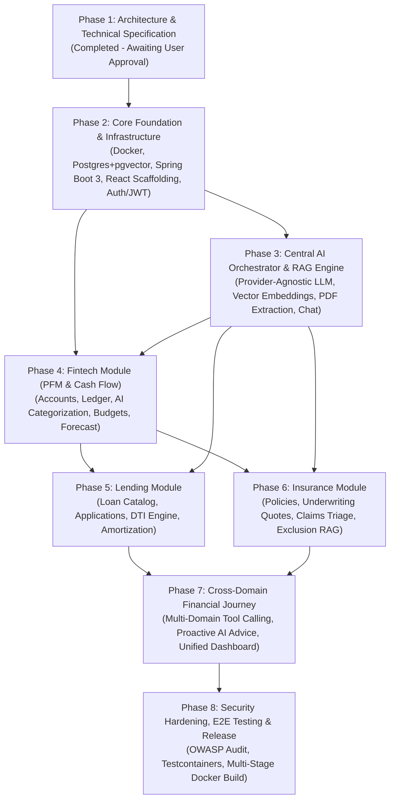

# FinPath AI — Comprehensive Development Roadmap

**Project:** FinPath AI (AI-Powered Financial Journey Platform)  
**Lifecycle Model:** Iterative Phase-Gated Agile Delivery  
**Current Phase:** Phase 1 (Architecture & System Specification) — Ready for Review  
**Next Phase:** Phase 2 (Foundational Infrastructure & Containerized Baseline)  

---

## 1. Development Sequence Overview & Dependency Graph

---

## 2. Phase-by-Phase Work Breakdown Structure (WBS)

### Phase 1: Architecture, Planning & Technical Specification (Current Phase)
- [x] Architectural design document (`ARCHITECTURE.md`).
- [x] Complete relational & vector database schema (`DATABASE_SCHEMA.md`).
- [x] Exhaustive REST API specification with OpenAPI/RFC 7807 contracts (`API_DESIGN.md`).
- [x] Complete directory structure mapping for frontend and backend (`FOLDER_STRUCTURE.md`).
- [x] Development roadmap and milestones (`DEVELOPMENT_ROADMAP.md`).
- [ ] **Gate Check**: Formal review and sign-off by Product / Lead Architect before coding commences.

---

### Phase 2: Foundational Infrastructure, Security & Base Scaffolding
*Goal: Stand up a production-ready containerized environment with zero application logic yet.*

- **Database & Containerization**:
  - Implement `docker-compose.yml` orchestrating `postgres:16` with the `pgvector` extension.
  - Setup Flyway migration directory and verify `V1__Initial_Schema.sql`.
- **Backend Core Scaffolding (Java 21 + Spring Boot 3)**:
  - Multi-module Gradle or single modular monolith Maven build (`pom.xml`) with Java 21 LTS toolchain.
  - Configure `spring-boot-starter-security`, `jjwt-api`, and stateless JWT authentication filter.
  - Implement global exception handling (`@RestControllerAdvice`) using RFC 7807 `ProblemDetail`.
  - Setup unified JPA auditing (`AuditorAware`, `@CreatedDate`, `@LastModifiedDate`).
- **Frontend Scaffolding (React 18 + TypeScript + Tailwind CSS)**:
  - Initialize Vite React + TypeScript project with strict compiler flags (`noImplicitAny`, `strictNullChecks`).
  - Configure Tailwind CSS, typography, Lucide icons, and Shadcn UI component primitives.
  - Implement Axios/Fetch HTTP client with automatic JWT token injection, correlation ID headers, and 401 refresh interceptors.
  - Implement authentication state management via Zustand and route guards for protected routes.
- **Verification Milestone**: User can register, log in, receive a valid JWT, view an empty authenticated dashboard shell, and execute authenticated API calls.

---

### Phase 3: Central AI Orchestrator & Document RAG Engine
*Goal: Deliver an enterprise-grade AI gateway with no vendor lock-in and high-speed semantic document retrieval.*

- **Provider-Agnostic LLM Gateway**:
  - Implement `LlmProviderService` interface supporting `generateText()`, `generateStreaming()`, and `generateEmbeddings()`.
  - Implement concrete adapters:
    - `OpenAiLlmProvider` (GPT-4o / text-embedding-3-small)
    - `GeminiLlmProvider` (Gemini 1.5 Pro / Flash)
    - `AnthropicLlmProvider` (Claude 3.5 Sonnet)
    - `OllamaLocalLlmProvider` (Llama 3 / Mistral for local zero-cost testing)
  - Create `LlmGatewayRouter` with Resilience4j circuit-breaker fallback routing.
- **Document Ingestion & RAG Pipeline**:
  - Integrate Apache Tika / PDFBox for textual parsing of uploaded PDF documents.
  - Implement `RecursiveCharacterTextSplitter` (chunk size: 800 tokens, 100 token overlap).
  - Persist chunk vectors to `document_chunks` using Spring Data JDBC / Native pgvector queries.
  - Implement Hybrid Search combining HNSW cosine vector similarity and PostgreSQL full-text search (`ts_rank`).
- **Conversational AI Core**:
  - Implement chat session memory (`ai_chat_sessions`, `ai_chat_messages`).
  - Implement Server-Sent Events (SSE) streaming endpoint `/api/v1/ai/chat/sessions/{id}/messages`.
  - Add client-side Markdown rendering and token-by-token streaming UI.

---

### Phase 4: Fintech Domain (PFM & Cash Flow)
*Goal: Provide users with transparent financial control through transaction aggregation and liquidity intelligence.*

- **Backend Ledger & Analytics**:
  - Implement `FinancialAccountService` and `TransactionService`.
  - Build rule-based transaction categorizer with fallback to LLM classification for obscure merchant descriptions.
  - Implement monthly budget limit monitor with threshold breach detection.
  - Create 30-day cash-flow forecast calculator factoring in recurring bills and salary cycles.
- **Frontend PFM Experience**:
  - Accounts summary card displaying liquid cash, total debt, and net worth.
  - Filterable, searchable transaction data table with category badges.
  - Interactive cash-flow projection chart using Recharts.
  - Dynamic budget progress meters with warning alerts.

---

### Phase 5: Lending Domain
*Goal: Enable frictionless digital borrowing, transparent loan simulation, and automated risk scoring.*

- **Backend Lending Engine**:
  - Implement `LoanProductService` and `LoanApplicationService`.
  - Develop mathematical loan amortization calculator generating month-by-month principal/interest tables.
  - Implement algorithmic Debt-To-Income (DTI) and loan-to-value (LTV) verification.
  - Create Underwriting Assistant tool that evaluates applicant income, credit score, and cash-flow stability.
- **Frontend Borrowing Experience**:
  - Loan product comparison marketplace (Personal, Auto, Mortgage).
  - Interactive EMI simulator slider (principal, APR, tenure) with real-time payment calculations.
  - Multi-step loan application wizard with payslip PDF upload drag-and-drop.
  - Application status timeline tracker (Submitted -> In Review -> Approved -> Disbursed).

---

### Phase 6: Insurance Domain
*Goal: Deliver personalized insurance discovery, policy document digestion, and expedited digital claims.*

- **Backend Insurance Engine**:
  - Implement `InsuranceProductService` and dynamic quote pricing engine based on risk parameters.
  - Implement policy binding and certificate generation service.
  - Build Claims Management service with automatic document association.
  - Integrate RAG-assisted claim triage: compare submitted incident description against policy exclusion clauses in the vector store.
- **Frontend Insurance Experience**:
  - Coverage needs analyzer and quote comparison grid.
  - Active policy repository with one-click document download.
  - Digital claim filing form with receipt upload and instant triage status indicator.

---

### Phase 7: Cross-Domain Financial Journey Orchestration
*Goal: Unify all three domains into an autonomous, proactive financial co-pilot.*

- **AI Multi-Tool Orchestration**:
  - Register domain tools in the AI Orchestrator:
    - `Fintech.getCashFlowSummary`
    - `Lending.calculateEligibility`
    - `Insurance.evaluateCoverageGaps`
  - Implement LangChain4j / Custom Function Calling dispatcher.
- **Holistic Journey Advisor**:
  - Create Proactive Advisor triggers:
    - *Scenario A*: High recurring surplus detected in Fintech -> suggest debt prepayment or insurance endowment.
    - *Scenario B*: Loan application submitted -> automatically assess whether borrower needs credit life insurance.
    - *Scenario C*: High-cost claim approved -> alert user to cash flow impact and emergency fund replenishment.
- **Unified Journey Dashboard**:
  - Single cockpit screen displaying financial health score, active loan obligations, insurance coverage status, and AI insights feed.

---

### Phase 8: Hardening, Testing, Performance Tuning & Deployment
*Goal: Ensure enterprise-grade security, fault tolerance, and turn-key Docker deployment.*

- **Quality Assurance & Testing**:
  - Unit test coverage > 80% on business calculations (DTI, amortization, quote pricing).
  - Integration testing with Testcontainers (real PostgreSQL + pgvector container).
  - End-to-end user journey tests via Playwright.
- **Security Hardening**:
  - OWASP Top 10 compliance audit (SQL injection, XSS, SSRF, CSRF).
  - Penetration testing of file upload endpoints (MIME type verification, path traversal prevention, file size limits).
  - Verify PII redaction rules before dispatching prompts to LLMs.
- **Production Containerization**:
  - Multi-stage Dockerfile for Spring Boot backend (Alpine JRE 21, non-root user).
  - Multi-stage Dockerfile for React SPA (Node 20 build -> Nginx Alpine production image).
  - Production `docker-compose.prod.yml` with health checks, restart policies, and resource constraints.

---

## 3. External Dependencies & Third-Party APIs

| Component / Service | Purpose | Fallback / Alternative |
| :--- | :--- | :--- |
| **OpenAI API** | Primary LLM (GPT-4o) & Embeddings (`text-embedding-3-small`) | Google Gemini 1.5 Pro / Anthropic Claude 3.5 |
| **Google Gemini API** | Secondary LLM & Document Multi-modal analysis | OpenAI GPT-4o / Claude 3.5 Sonnet |
| **Ollama (Local Engine)**| Offline development & zero-cost testing | Cloud LLM APIs |
| **Apache Tika & PDFBox**| Extraction of text and metadata from financial PDFs | In-house OCR / Tesseract |
| **PostgreSQL pgvector** | Vector similarity indexing (HNSW) | Milvus / Qdrant (Avoided for monolith simplicity) |
| **Plaid / Yodlee (Mocked)**| Banking account and transaction aggregation | Local mock bank simulator engine |
| **Credit Bureau (Mocked)**| FICO / VantageScore credit profile pulls | Local deterministic credit simulator |

---

## 4. Risk Analysis & Mitigation Matrix

| Identified Risk | Severity | Likelihood | Mitigation Strategy |
| :--- | :--- | :--- | :--- |
| **LLM Provider Outage or Rate Limit (429)** | High | Medium | Implement multi-provider fallback router with Resilience4j; system seamlessly shifts from OpenAI to Gemini or Anthropic. |
| **PII Data Exposure to External AI Providers** | Critical | Low | Implement pre-prompt regex/NLP sanitization layer. Strip SSNs, account numbers, and street addresses before transmitting context to external APIs. |
| **Vector Search Hallucination in Policy Inquiries** | High | Medium | Enforce strict temperature settings (0.0 - 0.2), require strict citations from `document_chunks`, and prompt-instruct the model to say *"Information not found in policy"* rather than guessing. |
| **Financial Computation Inaccuracies** | Critical | Low | Strictly isolate arithmetic from LLM generation. All interest calculations, EMIs, and DTIs are computed by deterministic Java math (`BigDecimal`) via tool calling, never hallucinated by LLM. |
| **Large PDF Parsing Bottlenecks** | Medium | Medium | Run PDF parsing and chunking asynchronously via Spring `@Async` virtual threads (`Project Loom`); client receives immediate `202 Accepted` and polls or listens to WebSocket. |

---

## 5. Phase 1 Sign-Off Gate Criteria

Prior to commencing Phase 2 (codebase initialization and Docker environment setup), the following criteria must be satisfied:
1. Technical architecture (`ARCHITECTURE.md`) approved.
2. Relational and vector schema (`DATABASE_SCHEMA.md`) approved.
3. REST API contracts (`API_DESIGN.md`) validated against business requirements.
4. Folder structure layout (`FOLDER_STRUCTURE.md`) validated.
5. Explicit user authorization received to proceed to Phase 2.

