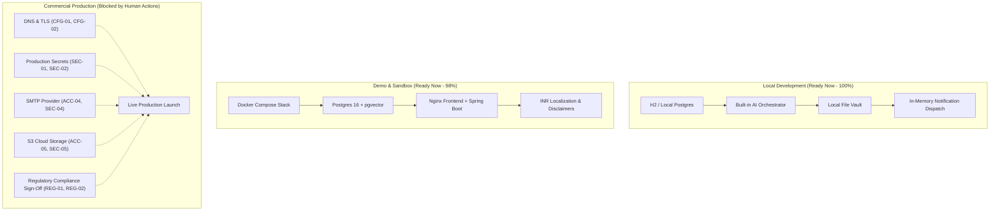

# FINPATH AI — Comprehensive Human Intervention Audit Report
**Version:** 2.0.0 (Post-Upgrade Phase 08)  
**Edition:** Paytm-Hyderabad Edition  
**Repository:** [https://github.com/aviii1229/FinPath-AI](https://github.com/aviii1229/FinPath-AI)  
**Audit Date:** November 2026  
**Auditor Roles:** Senior Software Architect, DevOps Engineer, Security Auditor, QA Engineer, Technical Project Manager  

---

## 1. Executive Summary

Following the full implementation and verification of **Foundational Modules** and **Upgrade Phases 01 through 08**, FinPath AI is architecturally complete, thoroughly tested (85+ backend tests and 49 frontend tests passing), and fully functional in local development and containerized simulation environments.

However, transitioning any high-security, multi-tenant financial platform from an offline/containerized developer environment to **Commercial Staging and Production** demands deliberate human decisions, credentials, legal disclosures, and infrastructure provisioning. **No autonomous AI or code generator can legally or physically procure third-party accounts, generate trusted SSL certificates, provision production DNS, or obtain regulatory sandbox approvals.**

This document provides an exhaustive, classified inventory of all human actions, credentials, configurations, and verification steps necessary to take FinPath AI from code repository to live operational deployment.

---

## 2. Priority Classification Matrix

Actions are categorized across four strict priority tiers:

| Priority | Tier Name | Definition | Deployment Blocker? |
|---|---|---|---|
| **P0** | **Blocker** | Required immediately for live deployment or production boot | **YES** (Prevents live traffic) |
| **P1** | **Critical** | Required for production security, privacy compliance, and data integrity | **YES** (Blocks public release) |
| **P2** | **Operational** | Required for external delivery channels (real emails, push, cloud object storage) | **NO** (Works with local simulations) |
| **P3** | **Enhancement** | Optimizations, advanced analytics, CI/CD pipelines, and scale tuning | **NO** (Post-launch improvements) |

---

## 3. Comprehensive Human Action Inventory

### 3.1. Account Creation (Third-Party Services)

| ID | Service / Provider | Purpose | Priority | Free Tier Available? | URL / Provider Portal |
|---|---|---|---|---|---|
| **ACC-01** | **Cloud Hosting Provider** (AWS, GCP, Azure, or DigitalOcean / Render) | Compute hosting for Spring Boot container, Nginx frontend, and managed PostgreSQL | **P0** | Yes (AWS Free Tier / GCP Free Credits / Render Free) | [AWS Console](https://aws.amazon.com/) / [Google Cloud](https://cloud.google.com/) |
| **ACC-02** | **Domain Registrar** (Cloudflare, GoDaddy, Namecheap) | Custom domain registration for frontend SPA and backend API endpoints | **P0** | No (~$10/year) | [Cloudflare Registrar](https://www.cloudflare.com/products/registrar/) |
| **ACC-03** | **Managed PostgreSQL Provider** (AWS RDS, Supabase, Neon, or Railway) | High-availability PostgreSQL 16+ instance with `pgvector` extension and automated daily snapshots | **P0** | Yes (Neon / Supabase Free Tiers) | [Neon.tech](https://neon.tech/) / [Supabase](https://supabase.com/) |
| **ACC-04** | **Transactional Email Service** (AWS SES, Resend, SendGrid, or Brevo) | Delivering real email notifications (welcome, EMI alerts, verification codes, security alerts) | **P1** | Yes (Resend: 3,000 emails/mo free, Brevo: 300/day free) | [Resend](https://resend.com/) / [SendGrid](https://sendgrid.com/) |
| **ACC-05** | **Cloud Storage Provider** (AWS S3, Google Cloud Storage, Cloudflare R2) | Production document vault storage for KYC, policy documents, and loan proofs | **P1** | Yes (AWS S3 5GB free, Cloudflare R2 10GB free) | [AWS S3](https://aws.amazon.com/s3/) / [Cloudflare R2](https://www.cloudflare.com/products/r2/) |
| **ACC-06** | **External LLM Gateway** *(Optional)* (OpenAI, Google AI Studio, Anthropic) | Cloud LLM integration if switching from built-in deterministic engine to cloud generative models | **P2** | Yes (Gemini API free tier / OpenAI pay-as-you-go) | [Google AI Studio](https://aistudio.google.com/) / [OpenAI Platform](https://platform.openai.com/) |
| **ACC-07** | **Error Tracking & APM** (Sentry, Datadog, New Relic) | Production exception monitoring, crash reporting, frontend telemetry | **P2** | Yes (Sentry Developer Free Tier: 5K events/mo) | [Sentry.io](https://sentry.io/) |

---

### 3.2. Credential Provisioning & Secret Generation

The human operator must generate and securely store the following production secrets. **Never commit these secrets into Git.**

| ID | Secret Name | Format / Length | How to Generate (PowerShell Command) | Target Environment Variable |
|---|---|---|---|---|
| **SEC-01** | **JWT Signing Secret** | Min 256-bit cryptographically secure string (Base64) | `[Convert]::ToBase64String((1..64 \| ForEach-Object { Get-Random -Minimum 0 -Maximum 256 }))` | `JWT_SECRET` |
| **SEC-02** | **Production DB Password** | High-entropy alphanumeric string (24+ chars) | `[System.Web.Security.Membership]::GeneratePassword(24, 6)` or password manager | `SPRING_DATASOURCE_PASSWORD` / `POSTGRES_PASSWORD` |
| **SEC-03** | **WebPush VAPID Keypair** | Public & Private VAPID EC keys | `npx web-push generate-vapid-keys` | `VAPID_PUBLIC_KEY` & `VAPID_PRIVATE_KEY` |
| **SEC-04** | **SMTP API Key / Password** | Provider-issued SMTP secret key | Generated in provider dashboard (e.g. Resend `re_...` or SendGrid `SG....`) | `SPRING_MAIL_PASSWORD` |
| **SEC-05** | **Cloud Storage S3 Keys** | Access Key ID & Secret Access Key | Generated in AWS IAM console with least-privilege S3 bucket policy | `AWS_ACCESS_KEY_ID` & `AWS_SECRET_ACCESS_KEY` |
| **SEC-06** | **External LLM Key** *(Optional)* | Provider API Key | Generated in Google AI Studio (`AIzaSy...`) or OpenAI (`sk-...`) | `GEMINI_API_KEY` / `OPENAI_API_KEY` |

---

### 3.3. Manual Infrastructure & Network Configuration

| ID | Component | Manual Task Description | Priority |
|---|---|---|---|
| **CFG-01** | **DNS Records (Apex & Subdomain)** | Configure `A` and `CNAME` records pointing domain (e.g., `finpath.example.com` and `api.finpath.example.com`) to Cloudflare or hosting load balancer. | **P0** |
| **CFG-02** | **SSL/TLS Certificates** | Enable Let's Encrypt automated TLS certificate issuance or upload wildcard SSL certificate to Nginx / Cloudflare CDN. | **P0** |
| **CFG-03** | **CORS Origin Lockdown** | In `backend/src/main/resources/application.yml` and `CorsConfig.java`, update `cors.allowed-origins` from development wildcards (`http://localhost:5173`) to the exact production domain(s) (`https://finpath.example.com`). | **P0** |
| **CFG-04** | **SMTP Email DNS Records** | Add **SPF**, **DKIM**, and **DMARC** TXT records to the domain DNS to guarantee deliverability of verification and alert emails. | **P1** |
| **CFG-05** | **Database pgvector Extension** | Ensure managed PostgreSQL instance has `vector` extension installed (`CREATE EXTENSION IF NOT EXISTS vector;`) prior to running Flyway migrations on blank database. | **P1** |
| **CFG-06** | **Document Storage Directory / Mount** | If retaining local disk storage, configure persistent container volume mount (`/app/storage/documents`) with proper read/write Linux permissions (`chown -R 1000:1000`). If migrating to S3, configure bucket name and lifecycle retention policies. | **P1** |
| **CFG-07** | **Frontend Environment Baking** | Ensure frontend Vite build environment has `VITE_API_BASE_URL` pointing to the live API gateway (`https://api.finpath.example.com/api/v1`) before executing `npm run build`. | **P0** |

---

### 3.4. External Approvals & Regulatory Compliance

Because FinPath AI deals with Indian financial instruments (Rupee pricing, insurance policies, lending eligibility, EMI calculations, DPDP Act 2023 compliance), the following human governance checks are required:

| ID | Item | Regulatory Framework / Authority | Human Requirement |
|---|---|---|---|
| **REG-01** | **Simulated Underwriting Disclaimer** | RBI & IRDAI Guidelines | Retain and verify visible UI disclaimers: *"FinPath AI provides simulated guidance for educational and planning purposes. We do not issue insurance policies or loan sanctions directly."* |
| **REG-02** | **DPDP Act 2023 Privacy Verification** | Digital Personal Data Protection Act, 2023 | Ensure Privacy Policy, Terms of Service, and Data Fiduciary details are accurately linked in `PrivacySettingsPage.tsx` and that the automated Data Erasure and Export mechanisms are active. |
| **REG-03** | **Credit Bureau Integration Consent** | RBI Credit Information Companies Act | When connecting real credit bureaus (CIBIL, Experian, CRIF High Mark), a explicit human consent flow with timestamped logging must be approved by the lending partner. |
| **REG-04** | **Payment Aggregator Integration** *(Future)* | RBI Payment Aggregator Guidelines | If taking real fee transactions, register merchant account with Paytm, Razorpay, or Cashfree and submit KYC documentation. |

---

### 3.5. Manual Verification & Smoke Test Protocol

Before releasing to end users, a designated QA/Lead Engineer must execute the following end-to-end verification checklist on the live deployment:

- [ ] **TC-01: User Onboarding & Auth Flow**
  - Register new account with strong password.
  - Verify JWT and refresh token cookie issuance.
  - Complete the 4-step smart onboarding wizard.
  - Verify profile initialization in PostgreSQL `users` and `user_profiles` tables.
- [ ] **TC-02: AI Orchestrator & Tool Invocation**
  - Prompt: *"I make ₹85,000 a month and need ₹5 Lakh personal loan, can you check my eligibility?"*
  - Verify AI extracts intent `LENDING_ELIGIBILITY`, calls `estimateLoanEligibility` tool, and outputs INR-formatted breakdown.
- [ ] **TC-03: Financial Health & Simulator**
  - Navigate to Fintech Analytics.
  - Verify Financial Health Score calculates correctly (0–100) with factor breakdowns.
  - Run What-If Simulator: add a ₹15,000 monthly expense, verify real-time impact on health score and runway.
- [ ] **TC-04: Document Intelligence & OCR**
  - Upload a test PDF / image bank statement into the Document Vault.
  - Verify Apache Tika OCR extraction finishes with `PROCESSED` status.
  - Ask document question in chat; verify source grounding references the uploaded document ID.
- [ ] **TC-05: Journey Management Engine**
  - Start an "Insurance Discovery Journey".
  - Advance steps (Requirement Collection -> Policy Comparison).
  - Verify persistence in `financial_journeys` and `journey_steps` tables.
- [ ] **TC-06: Proactive Notification Center**
  - Trigger a budget threshold simulation or test reminder.
  - Verify unread notification badge updates in real time.
  - Mark notification as read and verify database state change.
- [ ] **TC-07: Privacy Dashboard & DPDP Erasure**
  - Toggle marketing/analytics consent switches; verify persistence in `user_privacy_consents`.
  - Download personal data archive; verify valid JSON download containing user records.
  - Request account erasure; verify cascade deletion or anonymization across database tables.

---

## 4. Distinction: Local vs. Demo vs. Commercial Production Blockers



---

## 5. Prioritized Human Action Step-by-Step Playbook

```
PHASE 1: Immediate Security & Secret Generation (Day 1 — Est: 30 mins)
  Step 1: Generate high-entropy 512-bit JWT secret using PowerShell.
  Step 2: Generate random 32-character PostgreSQL root & application passwords.
  Step 3: Generate WebPush VAPID keypair (`npx web-push generate-vapid-keys`).
  Step 4: Populate local or server `.env` file from `.env.example`.

PHASE 2: Infrastructure & Cloud Provisioning (Day 1-2 — Est: 2 hours)
  Step 1: Provision managed PostgreSQL 16 on AWS RDS, Supabase, or Neon.
  Step 2: Enable `vector` extension in target database.
  Step 3: Create cloud object storage bucket (AWS S3 / Cloudflare R2).
  Step 4: Provision compute host (AWS ECS/App Runner or DigitalOcean Droplet).

PHASE 3: External Communications & Network Routing (Day 2 — Est: 1.5 hours)
  Step 1: Create Resend or SendGrid transactional email account.
  Step 2: Verify domain DNS records (SPF, DKIM, DMARC) for email sending.
  Step 3: Point domain A/CNAME records to live load balancer or Nginx server.
  Step 4: Provision SSL/TLS certificate via Let's Encrypt / Cloudflare.

PHASE 4: Deployment & Final Verification (Day 3 — Est: 2 hours)
  Step 1: Build & push backend Docker image to container registry.
  Step 2: Build frontend with live `VITE_API_BASE_URL`.
  Step 3: Run Flyway database migrations (`V1` to `V6`).
  Step 4: Execute Section 3.5 smoke test suite across all 8 modules.
  Step 5: Sign off on regulatory disclaimers and privacy policy links.
```

