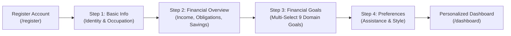

# FINPATH AI 2.0 | UPGRADE PHASE 02 DELIVERABLE
## Smart Onboarding & User Personalization

**Version:** 2.0.0  
**Phase:** Upgrade Phase 02  
**Target Environment:** Java 21, Spring Boot 3.4.2, React 19, Vite 8, TypeScript 5.9, PostgreSQL 16 + Flyway  
**Default Locale & Currency:** Indian Rupee (`INR` - `₹`, `en-IN`, Lakh/Crore numbering)  

---

## 1. Executive Summary

In Upgrade Phase 02 of **FinPath AI 2.0**, we upgraded the user registration and onboarding lifecycle into an intelligent, transparent, and multi-step personalization engine.

Instead of presenting a static or generic dashboard, the platform now captures the user's basic demographic profile, financial cashflow (in-hand income, living expenses, existing obligations, approximate savings), target goals (from 9 specialized financial domains), and assistance preferences. The engine then dynamically crafts:
1. A **Contextual Welcome Header** aligned to their preferred communication style (`ANALYTICAL`, `SIMPLE_CONCISE`, `EDUCATIONAL`).
2. **Prioritized Domain Modules** highlighting their selected interest areas with glowing badges.
3. **Recommended Financial Journeys** with direct actionable deep links and estimated completion times.
4. **Mathematical Financial Health Indicators** including live Debt-to-Income (FOIR) ratios and emergency reserve runway benchmarks.

### Verification Summary:
- **Frontend Test Suite:** **31 / 31** Vitest unit & integration tests passing (`100%`).
- **Frontend Production Build:** Vite 8 + TypeScript compiler (`tsc -b && vite build`) passed with **0 errors**.
- **Backend Test Suite:** **44 / 44** Spring Boot / JUnit 5 integration tests passing (`100%`).
- **Backward Compatibility:** Existing users (`sarah.connor@finpath.ai`) continue to work seamlessly with pre-seeded personalization profiles and zero migration breakages.

---

## 2. Smart Onboarding Wizard

The Onboarding Wizard is located at `/onboarding` and is linked directly from the registration flow (`/register`), the primary navigation sidebar, and the dashboard header.

### 2.1 Multi-Step User Flow



### 2.2 Detailed Step Breakdown

#### Step 1: Basic Information
- **Fields Collected:** First Name, Last Name, Age (number input, min 18), City/Tier (Bengaluru, Mumbai, Delhi NCR, Pune, Hyderabad, Chennai, Kolkata, Ahmedabad, Tier 2/3), Employment Category (`SALARIED`, `SELF_EMPLOYED`, `BUSINESS_OWNER`, `STUDENT`, `HOMEMAKER`, `RETIRED`, `OTHER`), Occupation (free text).
- **Privacy & Purpose Banner:** Transparent notice explaining: *"Demographic information is strictly utilized to calculate underwriting age bands and tax deduction frameworks under Indian tax law. We never sell your personal data."*

#### Step 2: Financial Overview
- **Fields Collected:**
  - Net Monthly In-Hand Income (`₹`)
  - Monthly Living Expenses (`₹`)
  - Existing Financial Obligations / EMIs (`₹`)
  - Approximate Liquid Savings & Investments (`₹`)
- **Real-Time Mathematical Health Preview:**
  - **Monthly Surplus:** Live computed as `Income - Expenses - Existing Obligations`.
  - **Debt-to-Income (FOIR):** Computed as `(Existing Obligations / Income) * 100%` with safe benchmark threshold (< 45%).
  - **Emergency Runway:** Computed as `Approximate Savings / Monthly Expenses` months.
- **Skip Optional Button:** Users can proceed with reasonable defaults if they prefer not to disclose numbers immediately.

#### Step 3: Financial Goals (Multi-Select Matrix)
Touch-friendly interactive selection cards spanning 9 core financial goals:
1. **Health Insurance (`HEALTH_INSURANCE`):** Comprehensive medical, hospitalization, and critical illness cover.
2. **Life Insurance (`LIFE_INSURANCE`):** High-sum-assured term life protection for dependents.
3. **Personal Loan (`PERSONAL_LOAN`):** Short-term borrowing for urgent needs or debt consolidation.
4. **Education Loan (`EDUCATION_LOAN`):** Financing for higher education, degree programs, and upskilling.
5. **Home Loan (`HOME_LOAN`):** Residential property purchase, construction, or balance transfer.
6. **Expense Management (`EXPENSE_MANAGEMENT`):** Automated transaction categorization and spending leakage tracking.
7. **Monthly Budgeting (`MONTHLY_BUDGETING`):** Category-wise spending limits with real-time overspending alerts.
8. **Savings Planning (`SAVINGS_PLANNING`):** Emergency buffer creation and high-yield goal milestones.
9. **Financial Education (`FINANCIAL_EDUCATION`):** Interactive AI coaching, terminology tutoring, and strategy walkthroughs.
- **Non-Stereotyping Notice:** Clearly affirms that all recommendations derive strictly from user-selected goals, avoiding assumptions based on age or job title.

#### Step 4: Preferences & Assistance Style
- **Assistance Method:**
  - `AI_CONVERSATIONAL`: AI Co-Pilot Guidance (Conversational chat, natural language advice).
  - `SELF_DIRECTED`: Self-Directed Exploration (Direct calculators, raw comparison matrices).
  - `STEP_BY_STEP`: Sequential Checklists (Milestone checklists and linear tracking).
- **Financial Knowledge Level:**
  - `BEGINNER`: Simple terms, zero jargon, clear explanations.
  - `INTERMEDIATE`: Comfortable with APR, deductibles, and FOIR.
  - `ADVANCED`: Deep mathematical models, amortizations, and risk ratios.
- **Communication Style:**
  - `ANALYTICAL`: Numeric breakdowns, ratios, and percentages.
  - `SIMPLE_CONCISE`: Key takeaways and direct action items.
  - `EDUCATIONAL`: Guided advice and coaching tips.
- **Target Milestones:** Short-term milestone (3–6 months) and long-term vision (1–5 years).

---

## 3. Personalization Engine Architecture

The personalization engine resides in `com.finpath.modules.personalization.service.PersonalizationService`:

### 3.1 Decision Logic & Mathematical Formulation
- **Surplus Formulation:**  
  $$\text{Monthly Surplus} = \text{Monthly Income} - \text{Monthly Expenses} - \text{Existing Obligations}$$
- **Debt-to-Income / FOIR Ratio:**  
  $$\text{FOIR (\%)} = \left(\frac{\text{Existing Obligations}}{\text{Monthly Income}}\right) \times 100$$
- **Savings Rate:**  
  $$\text{Savings Rate (\%)} = \left(\frac{\text{Monthly Surplus}}{\text{Monthly Income}}\right) \times 100$$
- **Emergency Reserve Runway:**  
  $$\text{Emergency Runway (Months)} = \left\lfloor\frac{\text{Approximate Savings}}{\text{Monthly Expenses}}\right\rfloor$$
- **Recommended Emergency Reserve Target:**  
  $$\text{Target Emergency Reserve} = \text{Monthly Expenses} \times 6$$

### 3.2 Dynamic Module Prioritization & Journey Synthesis
- **Goals $\cap$ Insurance:** Elevates `INSURANCE` module to `HIGH` priority and injects *"Compare Comprehensive Health & Life Policies"*.
- **Goals $\cap$ Lending:** Elevates `LENDING` module to `HIGH` priority and injects *"Check Real-Time Borrowing Power & EMIs"*.
- **Goals $\cap$ Fintech:** Elevates `FINTECH` module to `HIGH` priority and injects *"Establish Dynamic Category Spending Limits"*.
- **Goals $\cap$ Education:** Elevates `AI_ORCHESTRATOR` to `HIGH` priority and injects *"Financial Strategy Consultation"*.

---

## 4. Personalized Dashboard Features

The dashboard at `/dashboard` adapts dynamically based on user profile state:

1. **Contextual Welcome Banner:**
   - **Analytical Style:** *"Based on your ₹75,000 monthly income, your Fixed Obligation Ratio is 11.4% with a healthy 43.6% monthly savings rate. Your primary focus areas (Health Insurance, Smart Budgeting) are prioritized below."*
   - **Educational Style:** *"Welcome to FinPath AI! We have prepared an educational roadmap for your goals in Health Insurance, Smart Budgeting. Let's guide you step-by-step through smart liquidity and sustainable wealth creation."*
   - **Simple Style:** *"Hello! Here are your key financial priorities today. Focus on securing family coverage with your monthly surplus of ₹32,720."*
2. **Personalization Badge Pill:** Displays active focus areas (e.g. `Focus: Health Insurance, Smart Budgeting`).
3. **Quick Action "Personalization Settings" Button:** Direct shortcut allowing users to revisit `/onboarding` and reconfigure their parameters at any time.
4. **Personalized Suggested Journeys Grid:**
   - Displays 3 dedicated journey cards with estimated completion times (`3 min`, `4 min`, `5 min`), impact badges (`"High Protection"`, `"Low Cost Borrowing"`, `"Wealth Building"`), and instant action navigation buttons.
5. **Key Leverage & Runway Metrics:**
   - **Debt-to-Income (FOIR):** Badged as `HEALTHY` ($\le 45\%$) or `ATTENTION` ($> 45\%$).
   - **Emergency Reserve Buffer:** Shows liquid runway in months against the calculated 6-month target in INR.

---

## 5. Database Schema & Migration

### 5.1 JPA Entity Enhancements (`UserProfileEntity.java`)
Added the following fields with sensible defaults:
- `age`: `Integer`
- `employmentCategory`: `String` (length 50)
- `occupation`: `String` (length 100)
- `monthlyIncome`: `BigDecimal` (precision 15, scale 2, default `75000.00`)
- `monthlyExpenses`: `BigDecimal` (precision 15, scale 2, default `33740.00`)
- `existingObligations`: `BigDecimal` (precision 15, scale 2, default `8540.00`)
- `approximateSavings`: `BigDecimal` (precision 15, scale 2, default `345250.00`)
- `financialGoals`: `@ElementCollection` mapping to table `user_financial_goals`
- `preferredAssistance`: `String` (length 50, default `'AI_CONVERSATIONAL'`)
- `financialKnowledge`: `String` (length 50, default `'INTERMEDIATE'`)
- `communicationStyle`: `String` (length 50, default `'ANALYTICAL'`)
- `shortTermGoal`: `String` (length 255)
- `longTermGoal`: `String` (length 255)
- `onboardingCompleted`: `boolean` (default `false`)
- `onboardingStep`: `int` (default `0`)

### 5.2 Flyway Migration Script (`V2__Onboarding_Personalization.sql`)
```sql
ALTER TABLE user_profiles
    ADD COLUMN IF NOT EXISTS age INT,
    ADD COLUMN IF NOT EXISTS employment_category VARCHAR(50),
    ADD COLUMN IF NOT EXISTS occupation VARCHAR(100),
    ADD COLUMN IF NOT EXISTS monthly_income NUMERIC(15, 2) DEFAULT 75000.00,
    ADD COLUMN IF NOT EXISTS monthly_expenses NUMERIC(15, 2) DEFAULT 33740.00,
    ADD COLUMN IF NOT EXISTS existing_obligations NUMERIC(15, 2) DEFAULT 8540.00,
    ADD COLUMN IF NOT EXISTS approximate_savings NUMERIC(15, 2) DEFAULT 345250.00,
    ADD COLUMN IF NOT EXISTS preferred_assistance VARCHAR(50) DEFAULT 'AI_CONVERSATIONAL',
    ADD COLUMN IF NOT EXISTS financial_knowledge VARCHAR(50) DEFAULT 'INTERMEDIATE',
    ADD COLUMN IF NOT EXISTS communication_style VARCHAR(50) DEFAULT 'ANALYTICAL',
    ADD COLUMN IF NOT EXISTS short_term_goal VARCHAR(255),
    ADD COLUMN IF NOT EXISTS long_term_goal VARCHAR(255),
    ADD COLUMN IF NOT EXISTS onboarding_completed BOOLEAN NOT NULL DEFAULT FALSE,
    ADD COLUMN IF NOT EXISTS onboarding_step INT NOT NULL DEFAULT 0;

CREATE TABLE IF NOT EXISTS user_financial_goals (
    profile_id UUID NOT NULL REFERENCES user_profiles(id) ON DELETE CASCADE,
    goal_name VARCHAR(100) NOT NULL,
    PRIMARY KEY (profile_id, goal_name)
);

CREATE INDEX IF NOT EXISTS idx_user_financial_goals_profile ON user_financial_goals(profile_id);
```

---

## 6. REST API Contracts

| Method | Endpoint | Description | Auth Required |
| :--- | :--- | :--- | :---: |
| `GET` | `/api/v1/personalization` | Retrieve personalized dashboard configuration & journeys | Yes (`Bearer`) |
| `POST` | `/api/v1/personalization/onboarding/step` | Save intermediate step progress (1 to 4) | Yes (`Bearer`) |
| `POST` | `/api/v1/personalization/onboarding/complete` | Finalize onboarding and mark `onboardingCompleted = true` | Yes (`Bearer`) |
| `PUT` | `/api/v1/personalization/profile` | Update financial parameters and recalculate recommendations | Yes (`Bearer`) |

---

## 7. Testing & Verification Report

### 7.1 Backend Integration Tests (Spring Boot + JUnit 5 + MockMvc)
- **Suite:** `com.finpath.PersonalizationIntegrationTest` (3 test cases)
  - `testGetPersonalizationForSeedUser`: Verified seed user has completed onboarding, valid welcome message, and populated customization metrics.
  - `testFullOnboardingWorkflowForNewUser`: Verified registration $\to$ initial status $\to$ step saving $\to$ complete onboarding $\to$ correct surplus (`₹35,000`) and runway calculations.
  - `testUpdatePersonalizationProfile`: Verified dynamic update of income (`₹95,000`) and surplus recalculation (`₹47,000`).
- **All Backend Suites Combined:**
  - `AiChatIntegrationTest`: 6 / 6 passed
  - `AuthIntegrationTest`: 4 / 4 passed
  - `FinPathApplicationTests`: 1 / 1 passed
  - `FintechIntegrationTest`: 10 / 10 passed
  - `InsuranceIntegrationTest`: 10 / 10 passed
  - `LendingIntegrationTest`: 10 / 10 passed
  - `PersonalizationIntegrationTest`: 3 / 3 passed
  - **Total:** **44 / 44 tests passed (100%)**

### 7.2 Frontend Tests (Vitest + Testing Library)
- **Suite:** `src/test/onboarding.test.tsx` (5 test cases)
  - `navigates to /onboarding and renders Step 1 (Basic Information)`: **PASSED**
  - `advances through Step 1 to Step 2 (Financial Overview) and calculates live surplus`: **PASSED**
  - `advances to Step 3 (Financial Goals) and permits multi-selection`: **PASSED**
  - `completes Step 4 (Preferences) and redirects to Dashboard`: **PASSED**
  - `renders Personalized Dashboard with contextual recommendations and metrics`: **PASSED**
- **Existing Navigation Suite (`src/test/navigation.test.tsx`):** **26 / 26 passed**
- **Total Frontend Tests:** **31 / 31 passed (100%)**

### 7.3 Frontend Production Build
- `npm run build` (`tsc -b && vite build`) executed in **1.68s** with **0 errors**.

---

## 8. Conclusion

FinPath AI 2.0 Upgrade Phase 02 is complete, fully functional, and verified across both backend services and frontend interfaces. The user onboarding experience is transparent, privacy-respecting, and mathematically grounded, ensuring that every user receives recommendations tailored to their actual requirements and financial goals.

